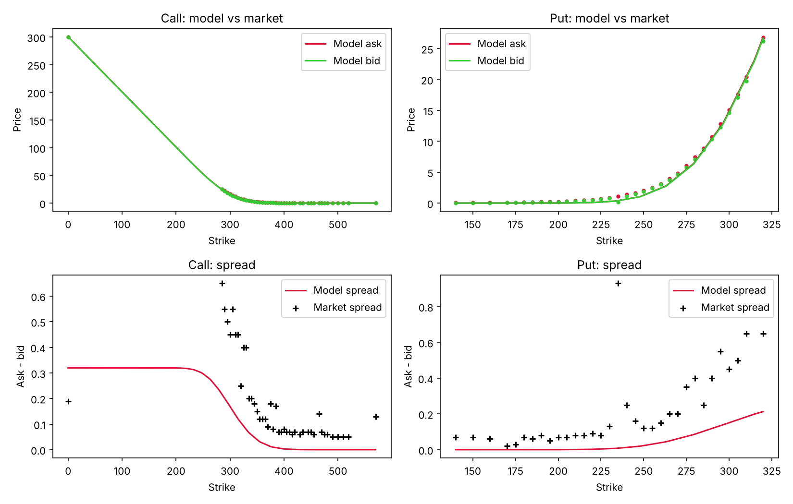
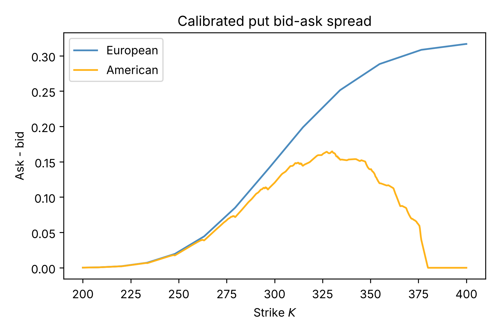
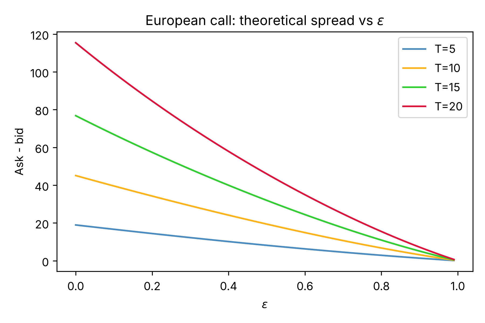
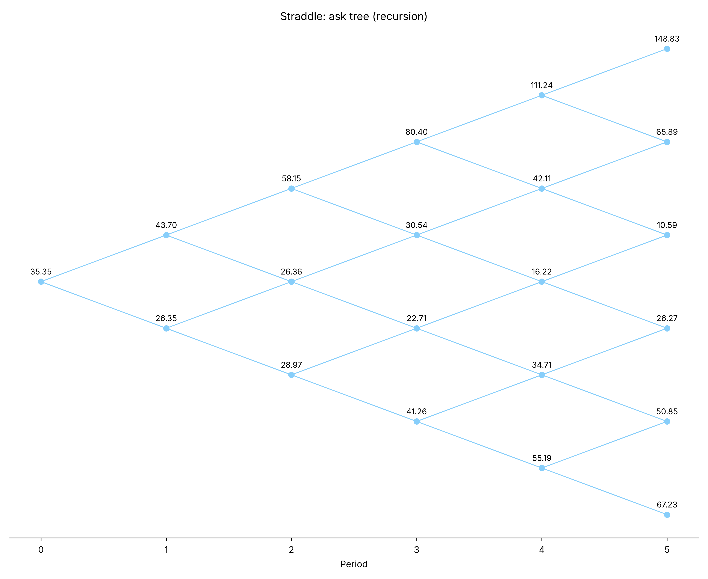

# DS Bid-Ask Option Pricing

Dynamic **bid-ask option pricing under Dempster-Shafer (DS) uncertainty** with a binomial DS
multiplicative random walk, calibrated to META option quotes (quote date 2023-09-29, expiry 2023-10-27,
T = 20 trading days) with Particle Swarm Optimisation.

* Bid/ask prices are lower/upper **Choquet expectations**; the gap `1 - b_u - b_d` measures ambiguity,
  and `b_u + b_d = 1` recovers the classical CRR model (zero spread).
* For **monotone payoffs** (calls, puts) the prices are closed-form binomial sums (thesis Prop. 4.1-4.2).
* For **any payoff** (straddles, American exercise) a general backward-recursion pricer is provided.
* Replicating portfolios and the self-financing property (Prop. 4.4) are implemented and tested.

## Install

```bash
pip install -e ".[dev]"            # core + pytest
pip install -e ".[fetch]"          # optional: live data download (yfinance, requests)
pip install -e ".[notebook]"       # optional: jupyter, to run the demo
pytest -q
```

## Quick start

```python
import numpy as np
from dsbidask import *

u, d, b_d = 1.02354592, 0.96425885, 0.39260853        # thesis calibration (free d)
print(european_call_bid_ask(300.11, 300, u, d, b_d, R_DEFAULT, 20))   # closed form
payoff = lambda s: np.abs(s - 300)                                     # straddle: not monotone
print(bid_ask(payoff, 300.11, u, d, b_d, R_DEFAULT, 20))               # general pricer
print(american_put_bid_ask(300.11, 350, u, d, b_d, R_DEFAULT, 20))     # early exercise
```

Walkthrough: [`notebooks/demo.ipynb`](notebooks/demo.ipynb). Calibrate: `python scripts/calibrate.py [--fixed-d]`.
Regenerate figures: `python scripts/make_figures.py`.

## Layout

| Path | Content |
|---|---|
| `src/dsbidask/pricing.py` | closed-form European bid/ask (scalar + vectorised over strikes), CRR, node-wise trees |
| `src/dsbidask/choquet.py` | general backward-recursion pricer (any payoff, optional American exercise), early-exercise nodes |
| `src/dsbidask/replication.py` | replicating portfolios and self-financing check (thesis Sec. 4.2) |
| `src/dsbidask/theory.py` | spread vs epsilon (Fig. 1), put spread vs strike, European vs American (Fig. 7) |
| `src/dsbidask/calibration.py` | vectorised squared-error objective and PSO (free `d` or `d = 1/u`) |
| `src/dsbidask/data.py`, `datasets/` | CSV loader and the four META option files |
| `src/dsbidask/fetch.py`, `scripts/fetch_quotes.py` | **free** live-data download (see below; not run here) |
| `src/dsbidask/plotting.py` | all plots, English labels only |
| `docs/THESIS_ERRATA.md` | audit of the thesis: data files, code, headers/captions |
| `tests/` | 13 tests (closed form vs recursion, CRR limit, replication, thesis numbers) |

## Results (reproduced)

| Fit | u | d | b_d | b_u | E |
|---|---|---|---|---|---|
| `d = 1/u` (PSO, seed 12345) | 1.029428 | 0.971413 | 0.502787 | 0.496474 | 21.950091 (matches thesis) |
| free `d`, thesis point | 1.023546 | 0.964259 | 0.392609 | 0.606494 | 15.4418 (matches thesis) |

Prices fit well (RMSE about 0.32 USD per quote) but model spreads (about 0.04 USD) are much narrower
than market spreads (about 0.2 USD). The free-`d` PSO result **depends on the seed**
(E between 10.3 and 19.5 for the seeds tried, with pyswarm 1.1.2), so 15.44 is one local optimum.

## Figures

| | |
|---|---|
|  |  |
|  |  |

## Live data (free sources; script provided, **not executed in this repo**)

`scripts/fetch_quotes.py TICKER YYYY-MM-DD` downloads the option chain with **yfinance** (free, no key,
what the thesis used), applies the thesis liquidity filter (spread <= 1 USD) and prints the 1-month
Treasury yield from **FRED** (series `DGS1MO`, free CSV, no key). `dsbidask.fetch.fetch_cboe_chain` is an
**untested** fallback to Cboe's delayed-quotes JSON. These services are unofficial/free tiers: expect
delays, rate limits and format changes. Option quotes are a snapshot, so calibrate on data downloaded
at one moment.

## Limitations

* Closed forms hold for **monotone payoffs only**; use `dsbidask.choquet` otherwise.
* The American extension (max of exercise and continuation, with lower/upper expectations) is **not** a thesis result.
* One quote date and one maturity; `R` is constant; no dividends (META paid none in 2023).
* Calibration box bounds (`u <= 1.056`, `0.3 <= b_d <= 0.6`) come from the thesis code, not from its stated problem (31).

## Advice for next steps (recorded, **not implemented**)

1. **Robust calibration:** multi-start PSO (many seeds, report best and spread), then polish with a local
   optimiser (`scipy.optimize.minimize`, constraint `b_u + b_d <= 1`); report seed dispersion in the thesis.
2. **Spread-aware objective:** weight errors by quoted spread (or fit mid-prices and spreads separately) so
   the model can reproduce the wider market spreads; consider a spread-level penalty.
3. **Zero-bid quotes:** decide whether bid = 0 options should be excluded or treated as censored.
4. **Several maturities / dates:** calibrate a term structure of `(u, d, b_d)` or time-varying `b_d`.
5. **Confidence intervals:** bootstrap the quotes to get parameter uncertainty.
6. **Continuous time:** map the parameters to a DS geometric Brownian motion limit (thesis outlook).
7. **CI and releases:** GitHub Actions running `pytest`; tag releases once the licence is chosen.

## Credits and licence

Based on Cinfrignini, Petturiti and Vantaggi, *Market consistent bid-ask option pricing under
Dempster-Shafer uncertainty*, Quantitative Finance (2024), doi:10.1080/14697688.2024.2353318, and the
authors' original code; accompanies the author's thesis extending that model.
**Licence: to be decided once the project is finished** (check the original code's licence first).
