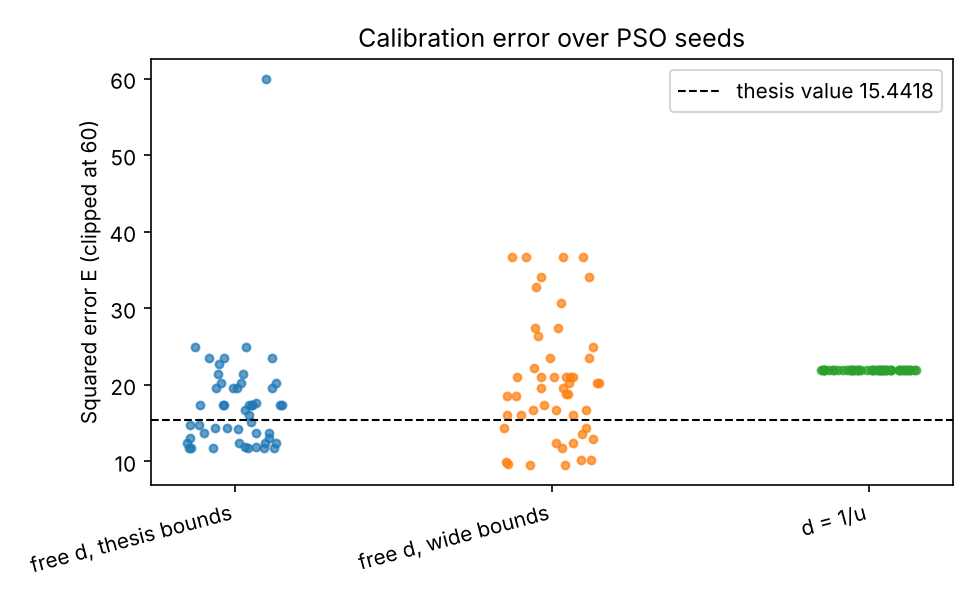
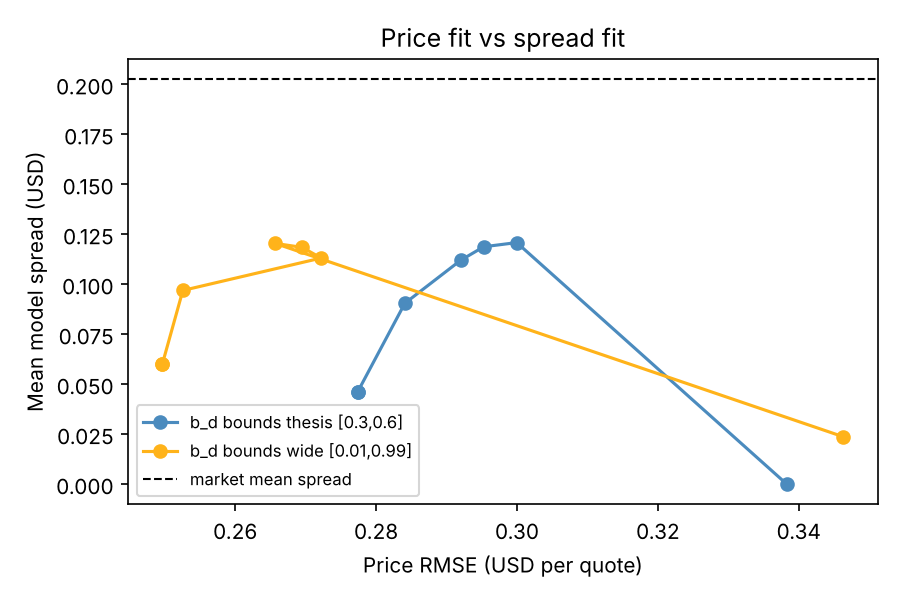

# DS Bid-Ask Option Pricing

**English** | [简体中文](README.zh-CN.md)

> 📄 **Read the full write-up: [`docs/report/REPORT.md`](docs/report/REPORT.md)** — the English edition of the thesis (theory, proofs,
> META calibration), with all corrections applied.

Dynamic **bid-ask option pricing under Dempster-Shafer (DS) uncertainty** with a binomial DS
multiplicative random walk, calibrated to META option quotes (quote date 2023-09-29, expiry 2023-10-27,
T = 20 trading days) with Particle Swarm Optimisation.

* Bid/ask prices are lower/upper **Choquet expectations**; the gap `1 - b_u - b_d` measures ambiguity,
  and `b_u + b_d = 1` recovers the classical CRR model (zero spread).
* For **monotone payoffs** (calls, puts) the prices are closed-form binomial sums (thesis Prop. 4.1-4.2).
* For **any payoff** (straddles, American exercise) a general backward-recursion pricer is provided.
* Replicating portfolios and the self-financing property (Prop. 4.4) are implemented and tested.

## Install

```bash
pip install -e ".[dev]"            # core + pytest
pip install -e ".[fetch]"          # optional: live data download (yfinance, requests)
pip install -e ".[notebook]"       # optional: jupyter, to run the demo
pytest -q
```

## Quick start

```python
import numpy as np
from dsbidask import *

u, d, b_d = 1.02354592, 0.96425885, 0.39260853        # thesis calibration (free d)
print(european_call_bid_ask(300.11, 300, u, d, b_d, R_DEFAULT, 20))   # closed form
payoff = lambda s: np.abs(s - 300)                                     # straddle: not monotone
print(bid_ask(payoff, 300.11, u, d, b_d, R_DEFAULT, 20))               # general pricer
print(american_put_bid_ask(300.11, 350, u, d, b_d, R_DEFAULT, 20))     # early exercise
```

Walkthrough: [`notebooks/demo.ipynb`](notebooks/demo.ipynb). Calibrate: `python scripts/calibrate.py [--fixed-d]`.
Regenerate figures: `python scripts/make_figures.py`.
Multi-start: `python scripts/calibrate.py --starts 50 --out results/free_d.csv` (add `--mode mid_spread --spread-weight 4` for a spread-aware fit).

## Layout

| Path | Content |
|---|---|
| `src/dsbidask/pricing.py` | closed-form European bid/ask (scalar + vectorised over strikes), CRR, node-wise trees |
| `src/dsbidask/choquet.py` | general backward-recursion pricer (any payoff, optional American exercise), early-exercise nodes |
| `src/dsbidask/replication.py` | replicating portfolios and self-financing check (thesis Sec. 4.2) |
| `src/dsbidask/theory.py` | spread vs epsilon (Fig. 1), put spread vs strike, European vs American (Fig. 7) |
| `src/dsbidask/calibration.py` | vectorised objective (thesis eq. 30 + spread-aware variants), PSO, multi-start with SLSQP polish |
| `src/dsbidask/data.py`, `datasets/` | CSV loader and the four META option files |
| `src/dsbidask/fetch.py`, `scripts/fetch_quotes.py` | **free** live-data download (see below; not run here) |
| `src/dsbidask/plotting.py` | all plots, English labels only |
| `docs/report/REPORT.md` | **English report**: translation of the thesis with corrections (figures in `docs/report/figures/`, made by `scripts/make_report_figures.py`) |
| `docs/thesis_corrections/` | corrected appendix code and ready-to-paste fixes for the Chinese thesis |
| `docs/THESIS_ERRATA.md` | audit of the thesis: data files, code, headers/captions |
| `docs/AMERICAN.md` | definition of the American put extension and what is verified |
| `results/` | multi-start tables and objective comparison (CSV) behind the numbers below |
| `README.zh-CN.md` | Chinese README (same content, with thesis section references) |
| `tests/` | 32 tests (closed form vs recursion, CRR limit, replication, American vs the authors' code, calibration) |
| `.github/workflows/tests.yml` | CI running `pytest` on Python 3.10/3.12/3.13 |

## Results (reproduced)

| Fit | u | d | b_d | b_u | E |
|---|---|---|---|---|---|
| `d = 1/u` (PSO, seed 12345) | 1.029428 | 0.971413 | 0.502787 | 0.496474 | 21.950091 (matches thesis) |
| free `d`, thesis point | 1.023546 | 0.964259 | 0.392609 | 0.606494 | 15.4418 (matches thesis) |

### Calibration robustness (50 PSO seeds, each polished with SLSQP; `results/multistart_*.csv`)

| Setting | best E | median E | worst E | comment |
|---|---|---|---|---|
| `d = 1/u` | 21.9501 | 21.9501 | 21.9501 | identical for every seed: well-conditioned |
| free `d`, thesis bounds (`b_d` in [0.3, 0.6]) | 11.69 | 17.06 | 4491 (one failed run) | best point has `b_d` **on the lower bound** (u = 1.0192, d = 0.9561) |
| free `d`, wide bounds (`b_d` in [0.01, 0.99]) | 9.47 | 19.54 | 36.7 | best `b_d` = 0.21, `b_u` = 0.789; only 2 of 50 seeds reach it |

So the thesis value 15.44 is a typical local optimum of the free-`d` problem, not its minimum, and the
`b_d >= 0.3` bound from the thesis code is active. Parameters differ a lot between near-equal errors:
report the range, not one seed.

### Price fit vs spread fit (`results/objective_comparison.csv`, 30 seeds per row)

Prices fit well (RMSE about 0.28 USD per quote) but model spreads (about 0.05 USD) are much narrower than
market spreads (about 0.20 USD). The thesis objective equals `2 x` the `"mid_spread"` objective with
`spread_weight = 0.25`. Weighting the spread error more raises the model spread to about 0.12 USD at a price
RMSE of about 0.30 USD, but it never reaches the market level: with one `b_d` the model cannot reproduce
market spreads in this setting (a possible reason is that the same `b_d` must serve all strikes, calls and
puts; this was not tested). The `"inv_spread"` objective collapses the spreads and is not recommended.

## Figures

| | |
|---|---|
|  |  |
|  |  |
|  |  |

## Live data (free sources; script provided, **not executed in this repo**)

`scripts/fetch_quotes.py TICKER YYYY-MM-DD` downloads the option chain with **yfinance** (free, no key,
what the thesis used), applies the thesis liquidity filter (spread <= 1 USD) and prints the 1-month
Treasury yield from **FRED** (series `DGS1MO`, free CSV, no key). `dsbidask.fetch.fetch_cboe_chain` is an
**untested** fallback to Cboe's delayed-quotes JSON. These services are unofficial/free tiers: expect
delays, rate limits and format changes. Option quotes are a snapshot, so calibrate on data downloaded
at one moment.

## Limitations

* Closed forms hold for **monotone payoffs only**; use `dsbidask.choquet` otherwise.
* The American extension (max of exercise and continuation, with lower/upper expectations) is **not** a thesis result; see `docs/AMERICAN.md` for what is verified.
* One quote date and one maturity; `R` is constant; no dividends (META paid none in 2023).
* Calibration box bounds (`u <= 1.056`, `0.3 <= b_d <= 0.6`) come from the thesis code, not from its stated problem (31).

## Done since the first review

Robust calibration (multi-start + SLSQP polish), spread-aware objectives, documented and tested American
extension, CI workflow, type hints and thesis-cited docstrings, 150-dpi figures (`--dpi 300` for print).

## Advice for next steps (recorded, **not implemented**)

1. **Zero-bid quotes:** the fitted set has 9 calls and 2 puts with bid = 0; decide whether to exclude them or treat them as censored.
2. **Several maturities / dates:** calibrate a term structure of `(u, d, b_d)` or a time-varying `b_d`; a single `b_d` cannot reproduce the market spreads.
3. **Confidence intervals:** bootstrap the quotes to get parameter uncertainty (the multi-start spread is only a first signal).
4. **Bounds:** justify or drop the `b_d >= 0.3` bound, which is active.
5. **Continuous time:** map the parameters to a DS geometric Brownian motion limit (thesis outlook).
6. **Releases:** the `tests` workflow passes on GitHub; tag a release (e.g. `v0.3.0`) when ready.

## Credits and licence

Released under the **MIT License** (see [`LICENSE`](LICENSE)): Copyright (c) 2024 Davide Petturiti
(original code) and Copyright (c) 2026 MeditatorLee (this derived work).

This project derives from the code of [itsdavide/bid-ask-DS](https://github.com/itsdavide/bid-ask-DS)
(MIT) accompanying A. Cinfrignini, D. Petturiti and B. Vantaggi, *Market consistent bid-ask option pricing
under Dempster-Shafer uncertainty*, Quantitative Finance (2024), doi:10.1080/14697688.2024.2353318. It
accompanies the author's thesis extending that model; the American-put recursion in
`tests/test_american.py` is a port of the original `AmericanPut.py` used as a reference.

Data: the bundled option quotes are a Yahoo Finance snapshot (2023-09-29) kept for reproducibility of the
thesis results; check Yahoo's terms before redistributing market data beyond that purpose.
