# Dynamic Bid–Ask Option Pricing under Dempster–Shafer Uncertainty

### Theory, closed-form pricing rules and calibration to META options

*English edition of the author's Chinese thesis, with the corrections of [`docs/THESIS_ERRATA.md`](../THESIS_ERRATA.md) applied.*

> **About this report.** This is a translation and reorganisation of the thesis
> *Dempster–Shafer 证据理论下的动态买卖定价* into a GitHub-readable report. The model is the one of
> Cinfrignini, Petturiti and Vantaggi, *Dynamic bid–ask pricing under Dempster–Shafer uncertainty*,
> J. Math. Econ. 107 (2023) 102871 (reference [17]) — the thesis restates it, proves the special properties of
> European bid–ask prices, and calibrates it to META options. All numbers below were recomputed with the code in this
> repository (`src/dsbidask/`). Where the thesis was wrong, the text here is already corrected; the changes are
> listed in [Editorial changes](#editorial-changes) at the end, and every figure was regenerated by
> [`scripts/make_report_figures.py`](../../scripts/make_report_figures.py).

---

## Abstract

Traditional no-arbitrage pricing theory relies on frictionless markets and therefore cannot explain the bid–ask spreads
observed in real markets. Classical models do not capture the effect of transaction costs, liquidity risk and
information asymmetry on prices, and in periods of extreme volatility the failure of linear hedging strategies becomes
conspicuous.

Within the framework of Dempster–Shafer evidence theory, this report presents a dynamic bid–ask pricing model based on
a measure of uncertainty, which overcomes the linear constraints of classical arbitrage-free pricing in frictionless
markets. By introducing the DS-multiplicative random walk and the DS-geometric Brownian motion, we define the
risk-neutral belief function and the corresponding conditional Choquet expectation operator, a new theoretical tool for
pricing European options in frictional markets. We show that, for non-decreasing (non-increasing) contract functions, the
bid (ask) pricing formula does not depend on the parameter $\widehat{b_d}$ and the replication strategy is
self-financing; that the pricing formulas can be computed explicitly by generalising the classical binomial tree; and
that the model can be calibrated to market data with Particle Swarm Optimisation (PSO). On META stock options the
calibrated model fits the market bid and ask **prices** well (root-mean-square error of about 0.32 USD per quote) and
the theoretical put-spread curve has the same shape as the market spreads (increasing in the strike); with a single
spread parameter $\widehat{b_d}$, however, the **level** of the model spreads is too narrow (about 0.04 USD on average
against 0.20 USD in the market). The study provides theoretical support for understanding dynamic pricing in frictional
markets and prepares extensions to continuous-time models.

**Keywords:** Dempster–Shafer theory; dynamic bid–ask pricing; DS-multiplicative random walk; conditional Choquet
expectation; market calibration

## Contents

1. [Introduction](#1-introduction)
2. [Preliminaries](#2-preliminaries)
3. [Theoretical framework of the DS bid–ask binomial model](#3-theoretical-framework-of-the-ds-bidask-binomial-model)
4. [Dynamic pricing rules with bid–ask spreads](#4-dynamic-pricing-rules-with-bidask-spreads)
5. [Calibration to market data](#5-calibration-to-market-data)
6. [Conclusions and outlook](#6-conclusions-and-outlook)
- [Appendix A — Proofs](#appendix-a--proofs)
- [Appendix B — Code](#appendix-b--code)
- [Editorial changes](#editorial-changes)
- [References](#references)

---

## 1. Introduction

### 1.1 Background and significance

Against the background of deeply interconnected global financial markets, the opening-up of China's capital market has
accelerated markedly, and the volume of domestic derivatives and option contracts has grown significantly in recent
years. The central role of options as risk-hedging instruments is obvious, and their theory has always interacted with
market practice. The continuous-time finance models pioneered by Merton [1] laid the foundation for the dynamic analysis
of securities pricing, and the Black–Scholes formula derived in Duffie [2] established the replication paradigm for
arbitrage-free portfolios in frictionless markets. Under complete markets and the absence of arbitrage, the value of any
portfolio can be replicated exactly by a risk-free bond and a stock: the long or short risk of an option is hedged
completely by a replicating strategy, so the arbitrage-free market value of an option in a frictionless market is
determined by the market values of the bond and the stock. Traditional option pricing methods — partial differential
equations, discrete-model approximations, martingale methods — all depend strictly on the completeness assumption, as
noted by Pliska [3] and Cox et al. [4]. When real markets feature transaction costs, poor liquidity or information
asymmetry, such theories cannot explain what is observed. For example, Amihud and Mendelson [5, 6] showed that frictions,
typically in the form of bid–ask spreads, are pervasive in real markets.

Overall, the theoretical difficulties of traditional probability-measure approaches are of two kinds. First, the
arbitrage-free pricing assumptions of classical probability measures can hardly describe the evolution of prices under
information asymmetry — especially in international markets where cross-border information asymmetry and heterogeneous
regulation coexist, where the very existence of a risk-neutral measure is in question. Second, linear hedging strategies
fail with increasing frequency in extreme markets; the discontinuous jumps of the SPX option implied-volatility surface
during the 2020 US market circuit breakers are a typical example. These difficulties drive pricing theory from complete
to incomplete markets and promote research on the fusion of multiple probability measures and non-linear hedging. On the
other hand, the complete-market assumption directly induces a linear pricing rule — the discounted conditional
expectation under the risk-neutral probability is linear — which is the main reason the assumption is so widely used.
When one builds a pricing model for an incomplete market and takes bid and ask prices into account, however, the
linearity restriction must be abandoned.

Ambiguity pricing and frictional markets were pioneered by Araujo et al. [7] and Cerreia-Vioglio et al. [8]. More
recently, Bastianello et al. [9] studied the explicit form of non-linear pricing formulas, and Chateauneuf and Cornet
[10] studied risk-neutral non-additive measures and their properties. Within the Dempster–Shafer (DS) evidence-theory
framework and belief-function uncertainty also used here, Cinfrignini et al. [11] proposed equivalent martingales for
ambiguous measures. For markets with bid–ask spreads, Petturiti and Vantaggi [12] used DS theory with imprecise
probabilities to study and implement the no-arbitrage principle, giving a new approach to dynamic bid–ask pricing.

Several constructions of dynamic bid–ask pricing models already exist; representative studies are the axiomatic approach
of Jouini [13], the time-consistent pricing framework of Bion-Nadal [14] and the conic-market model of Carr and Zhu
[15]. Driouchi et al. [16] studied dynamic pricing in a Choquet framework, but without modelling bid–ask spreads.

### 1.2 Contents and contributions

**Contents.** We adopt the model of Cinfrignini et al. [17], built on the *DS-multiplicative random walk*. This process is
time-homogeneous Markov and has the advantage of being characterised by a single family of transition belief functions
with just two strictly positive parameters. In a mixed market with a default-free bond and a non-dividend-paying stock, we
assume the stock bid price follows a DS-multiplicative random walk. We showed the existence of a risk-neutral belief
function that has both the one-step Choquet martingale property and the global Choquet supermartingale property. For
European options whose payoff depends on the stock bid price, the dynamic lower (bid) pricing formula is the discounted
one-step conditional Choquet expectation under the risk-neutral belief function; the corresponding dynamic upper (ask)
pricing formula follows by step-wise dualisation.

While reviewing the dynamic bid–ask pricing model of [17], we extend its results by establishing special properties of
European bid–ask pricing rules and computing European bid–ask prices by generalising the classical binomial tree. We
show that for non-decreasing (non-increasing) contract functions the bid (ask) pricing formula is independent of the
choice of $\widehat{b_d}$, and hence that for non-decreasing (non-increasing) contract functions the bid (ask) replicating
strategy is self-financing, whereas the ask (bid) replicating strategy is not.

The model has interpretable risk-neutral parameters, from which a market-consistent calibration procedure follows. The
calibration uses the bid and ask quotes of European calls and puts on a non-dividend stock, for a fixed maturity and a set
of strikes, and is carried out by minimising a squared error. The minimisation is a constrained optimisation of an
objective function that contains maximum operations, and even for small option samples a linearisation based on binary
random vectors makes the computational complexity explode. We therefore use the Particle Swarm Optimisation algorithm
(PSO) of Kennedy and Eberhart [18], a stochastic incomplete method. The results show that it calibrates market bid and ask
quotes effectively.

**Outline.** Chapter 2 reviews the theoretical foundations: Section 2.1 introduces Dempster–Shafer theory and Section 2.2
the conditioning rule under DS uncertainty and the Choquet conditional expectation. Chapter 3 lays out the theoretical
framework of the bid–ask binomial model: Section 3.1 the DS-multiplicative random walk, Section 3.2 the risk-neutral
belief function (the equivalent one-step Choquet martingale belief function), and Section 3.3 a normative justification
of the model through dynamic no-arbitrage. Chapter 4 presents dynamic bid–ask pricing rules: Section 4.1 describes
European bid and ask prices, generalising the binomial formula to non-additive uncertainty measures for non-decreasing and
non-increasing contract functions, and Section 4.2 discusses replicating strategies. Chapter 5 calibrates the model to
market data by minimising the squared error of European call and put quotes, and uses the calibrated model to price
European puts. Chapter 6 concludes and outlines future work. All proofs are in Appendix A.

**Contribution.** The core novelty is the DS-multiplicative random walk and the DS-geometric Brownian motion with the
corresponding conditional Choquet expectation operator. The operator is essentially a completely monotone conditional
operator generated by a global belief function, based on the conditioning axioms of Suppes and Zanotti [19]. The European
bid–ask pricing formulas built on it offer a new approach to option pricing and enrich the literature.

---

## 2. Preliminaries

### 2.1 Dempster–Shafer uncertainty

Let $\Omega=\lbrace \omega_1,\dots,\omega_d\rbrace$ be a finite non-empty set of states and $\mathcal{F}=\mathcal{P}(\Omega)$ its power
set. Let $\mathbb{R}^{\Omega}$ denote the set of all random variables on $\Omega$. Unlike classical probability, the
Dempster–Shafer theory of Dempster [20] and Shafer [21] quantifies uncertainty with a non-additive measure called a
*belief function*: a map $\nu:\mathcal{F}\to[0,1]$ such that

1. $\nu(\varnothing)=0$ and $\nu(\Omega)=1$;
2. for every $k\ge 2$ and $A_1,\dots,A_k\in\mathcal{F}$,
   $$\nu\Big(\bigcup_{i=1}^{k}A_i\Big)\ \ge \sum_{\varnothing\neq I\subseteq\lbrace 1,\dots,k\rbrace}(-1)^{|I|+1}\,\nu\Big(\bigcap_{i\in I}A_i\Big).$$

Condition 2 is called complete monotonicity. If it holds with equality, $\nu$ reduces to a classical probability measure
(usually denoted $P$). Every belief function has an associated set function, the *plausibility function*
$\overline{\nu}:\mathcal{F}\to[0,1]$, defined for all $A\in\mathcal{F}$ by

$$\overline{\nu}(A)=1-\nu(A^{c}).$$

Both $\nu$ and $\overline{\nu}$ are determined by the *Möbius inverse* $\mu:\mathcal{F}\to[0,1]$ of $\nu$, a set function with
$\mu(\varnothing)=0$ and $\sum_{B\in\mathcal{F}}\mu(B)=1$; for every $A\in\mathcal{F}$,

$$\nu(A)=\sum_{B\subseteq A}\mu(B)\qquad\text{and}\qquad \overline{\nu}(A)=\sum_{B\cap A\neq\varnothing}\mu(B).$$

Every belief function induces a non-empty closed convex set of probability measures on $\mathcal{F}$, its *core*,

$$\mathrm{core}(\nu)=\lbrace P:\ P\text{ is a probability measure on }\mathcal{F},\ P\ge\nu\rbrace.$$

Belief and plausibility can then be written, for every $A\in\mathcal{F}$, as

$$\nu(A)=\min_{P\in\mathrm{core}(\nu)}P(A)\qquad\text{and}\qquad \overline{\nu}(A)=\max_{P\in\mathrm{core}(\nu)}P(A),$$

so $\nu$ and $\overline{\nu}$ are a lower and an upper probability.

### 2.2 Choquet conditional expectation

Conditioning in Dempster–Shafer theory is still an open question. We use the *multiplicative (geometric) conditioning rule*
of Suppes and Zanotti [19]: for $E,H\in\mathcal{F}$ with $\nu(H)>0$,

$$\nu(E\mid H)=\frac{\nu(E\cap H)}{\nu(H)} \qquad(1)$$

The conditional belief function again induces a conditional core, $\mathrm{core}(\nu(\cdot\mid H))$. Two other common choices
are Dempster's rule and the Bayesian rule: for $E,H\in\mathcal{F}$ with $\nu(H)>0$,

$$\nu_D(E\mid H)=1-\frac{\overline{\nu}(E^{c}\cap H)}{\overline{\nu}(H)}=\frac{\nu\big((E\cap H)\cup H^{c}\big)-\nu(H^{c})}{1-\nu(H^{c})},$$

$$\nu_B(E\mid H)=\min\Big\lbrace \frac{P(E\cap H)}{P(H)}:P\in\mathrm{core}(\nu)\Big\rbrace=\frac{\nu(E\cap H)}{\nu(E\cap H)+\overline{\nu}(E^{c}\cap H)}.$$

Given $\nu(\cdot\mid H)$ and $X\in\mathbb{R}^{\Omega}$, the *conditional Choquet expectation* of $X$ with respect to
$\nu(\cdot\mid H)$ is defined through the Choquet integral of Choquet [22],

$$\oint X(\omega)\,d\nu(\omega\mid H)=\sum_{i=1}^{d}\Big(X(\omega_{\sigma(i)})-X(\omega_{\sigma(i+1)})\Big)\,\nu\big(E_i^{\sigma}\mid H\big) \qquad(2)$$

where $\sigma$ is a permutation of $\Omega$ with $X(\omega_{\sigma(1)})\ge\dots\ge X(\omega_{\sigma(d)})$,
$E_i^{\sigma}=\lbrace \omega_{\sigma(1)},\dots,\omega_{\sigma(i)}\rbrace$ for $i=1,\dots,d$, and $X(\omega_{\sigma(d+1)})=0$.
Moreover, through the conditional core, the conditional Choquet expectation can be regarded as a *local lower expectation*
given $H$, because

$$\oint X(\omega)\,d\nu(\omega\mid H)=\min_{P\in\mathrm{core}(\nu(\cdot\mid H))}\int X(\omega)\,dP(\omega) \qquad(3)$$

Furthermore, for the dual plausibility function $\overline{\nu}(\cdot\mid H)$ of $\nu(\cdot\mid H)$,

$$\oint X(\omega)\,d\overline{\nu}(\omega\mid H)=-\oint\big(-X(\omega)\big)\,d\nu(\omega\mid H)=\max_{P\in\mathrm{core}(\nu(\cdot\mid H))}\int X(\omega)\,dP(\omega),$$

which is a *local upper expectation* given $H$.

---
## 3. Theoretical framework of the DS bid–ask binomial model

### 3.1 The DS-multiplicative random walk and its extension

Following Cinfrignini et al. [17], we build a model for stock bid and ask prices on the discrete time set
$\lbrace 0,\dots,T\rbrace$, where $T\in\mathbb{N}$ is a finite horizon. This section presents the theory and use of the
DS-multiplicative random walk.

Consider a discrete-time portfolio in a mixed market with one default-free bond in a frictionless market and one
non-dividend-paying stock in a frictional market (transaction costs or information asymmetry). The bond price follows a
deterministic process $\lbrace B_n\rbrace_{n=0}^{T}$ with $B_0=1$ and, for $n=1,\dots,T$,

$$B_n=(1+r)B_{n-1} \qquad(4)$$

where $1+r>0$ and $r$ is the one-period risk-free rate over the holding period. The stock *bid* price follows a stochastic
process $\lbrace S_n\rbrace_{n=0}^{T}$ such that, for $n=1,\dots,T$,

$$S_n=\begin{cases}u\,S_{n-1}&\text{if the stock goes up,}\\ d\,S_{n-1}&\text{if the stock goes down,}\end{cases} \qquad(5)$$

with $S_0=s_0>0$ and $u>d>0$ the up and down factors.

All processes live on the filtered measurable space $(\Omega,\mathcal{F},\lbrace \mathcal{F}_n\rbrace_{n=0}^{T})$ with
$\Omega=\lbrace 1,\dots,2^{T}\rbrace$, where $\mathcal{F}_n$ is the algebra generated by $\lbrace S_0,\dots,S_n\rbrace$, $\mathcal{F}_0=\lbrace \varnothing,\Omega\rbrace$
and $\mathcal{F}_T=\mathcal{P}(\Omega)$.

The paths of $\lbrace S_n\rbrace$ are drawn on a recombining binomial tree; every state $\omega\in\Omega$ is a unique path,
corresponding to the $T$-bit binary expansion of $\omega-1$. For $n=1,\dots,T$ put
$\mathcal{A}_n=\lbrace a_k=u^{k}d^{\,n-k}:k=0,\dots,n\rbrace$ and, for $s>0$ and $A\in\mathcal{P}(\mathcal{A}_n)$,
$As=\lbrace a_k s:a_k\in A\rbrace$. The range of $S_n$ is $\mathcal{S}_n=\mathcal{A}_n s_0$.

Uncertainty is measured by a belief function $\nu:\mathcal{F}\to[0,1]$ chosen so that the $t$-step transitions form a
family $\lbrace \beta_t\rbrace_{t=1}^{T}$ determined by only two parameters $b_u,b_d\in(0,1)$ with $b_u+b_d\le 1$, interpreted as the
one-step conditional beliefs in an up and a down move. For $t=1,\dots,T$ and $A\in\mathcal{P}(\mathcal{A}_t)$,

$$\beta_t(A)=\sum_{a_k\in A}\binom{t}{k}b_u^{k}b_d^{\,t-k}+\sum_{[a_k,a_{k+j}]\subseteq A,\ j\ge 1}\binom{t-j}{k}b_u^{k}b_d^{\,t-j-k}\big(1-(b_u+b_d)\big) \qquad(6)$$

where, for $i\le j$, $[a_i,a_j]=\lbrace a_k\in\mathcal{A}_t:a_i\le a_k\le a_j\rbrace$.

Cinfrignini et al. [17] proved that there is a strictly positive belief function $\nu$ on $\mathcal{F}$ under which
$\lbrace S_n\rbrace_{n=0}^{T}$ is Markov and time-consistent with transition conditional beliefs given by (6); such a process is
called a **DS-multiplicative random walk**. Concretely, for all $0\le n\le T-1$, $1\le t\le T-n$,
$A\in\mathcal{P}(\mathcal{A}_t)$ and $s_0\in\mathcal{S}_0,\dots,s_n\in\mathcal{S}_n$,

$$\nu\big(S_{n+t}\in As_n\mid S_0=s_0,\dots,S_n=s_n\big)=\nu\big(S_{n+t}\in As_n\mid S_n=s_n\big)=\beta_t(A)\qquad(7)$$

Infinitely many belief functions make the process a DS-multiplicative random walk, all constrained by the family
$\lbrace \beta_t\rbrace$; we choose (6) for its excellent interpretability and minimal parametrisation. In fact $\beta_t$ in (6) is a
binomial-like belief distribution that also takes into account the *interval* beliefs in $A$, with the interval weight
reduced to $1-(b_u+b_d)$: $\beta_t(A)$ sums binomial-like weights over all path segments of decreasing length, which are
exactly the evidence that the process lies in $As_n$. If $b_u+b_d=1$, $\beta_t$ reduces to the classical binomial
distribution with parameters $b_u$ and $t$. The rich parametrisation of (6) and its role in calibration are discussed in
Chapter 5.

*Continuous-time limit.* To extend the model, consider the limit of continuous time, which yields a DS-geometric Brownian
motion. As for the classical binomial model, replace the time step by $\Delta t$ with $t=N\Delta t$ and re-parametrise the
one-step beliefs as $b_u=\lambda\Delta t+o(\Delta t)$, $b_d=\mu\Delta t+o(\Delta t)$. The $t$-step transition belief becomes

$$\beta_t^{\Delta t}(A)=\sum_{k=0}^{t}\binom{t}{k}(\lambda\Delta t)^{k}(\mu\Delta t)^{t-k}\mathbf 1_{\lbrace a_k\in A\rbrace}
+\sum_{j=1}^{t-1}\binom{t-j}{j}(\lambda\Delta t)^{j}(\mu\Delta t)^{t-j}\big(1-(\lambda+\mu)\Delta t\big)\mathbf 1_{\lbrace [a_j,a_{t-j}]\subseteq A\rbrace}.$$

Letting $\Delta t\to0$ and extending the Poisson limit theorem as in the discrete-time model of [17] gives the continuous
$t$-step transition belief of the DS-geometric Brownian motion, with $\sigma^2=\lambda+\mu$ the diffusion intensity:

$$\beta(A,t)=e^{-(\lambda+\mu)t}\sum_{p=0}^{\infty}\frac{(\lambda t)^{p}}{p!}\mathbf{1}_{\lbrace a_p\in A\rbrace}+\sum_{m<n}\int_0^{t}\frac{(\lambda\mu s)^{n-m}}{(n-m)!}e^{-(\lambda+\mu)s}\frac{(s\sigma^{2})^{n-m-1}}{\Gamma(n-m)}\mathbf{1}_{\lbrace [a_m,a_n]\subseteq A\rbrace}\;ds$$

(These limit formulas are quoted from the thesis, which takes them from [17]; the continuous-time theory is outside the
scope of this report and is listed as future work in Chapter 6.) This continuous-time model keeps the ability of DS theory
to handle incomplete knowledge while generating paths in a way similar to the classical geometric Brownian motion; its
study relies on the Choquet weak convergence of Feng and Nguyen [23].

### 3.2 The equivalent one-step Choquet martingale belief function

So far the belief space $(\Omega,\mathcal{F},\lbrace \mathcal{F}_n\rbrace,\nu)$ adjusted from the "real world" has been fixed. For
$X\in\mathbb{R}^{\Omega}$, define the random variables $C[X\mid\mathcal{F}_n]$ and $C[X\mid S_0,\dots,S_n]$ on
$\lbrace S_0=s_0,\dots,S_n=s_n\rbrace$ by

$$C[X\mid\mathcal{F}_n](\omega):=C[X\mid S_0,\dots,S_n](\omega):=\oint X\,d\nu(\cdot\mid S_0=s_0,\dots,S_n=s_n)\qquad(8)$$

and $C[X\mid S_n]$ analogously from $\nu(\cdot\mid S_n=s_n)$. The operator $C[\cdot\mid\mathcal{F}_n]$ is called the
conditional Choquet expectation. For $0\le n\le T-1$, $1\le t\le T-n$ and any real function $\varphi$ on the range of
$S_{n+t}$, (7) gives

$$C\big[\varphi(S_{n+t})\mid\mathcal{F}_n\big]=C\big[\varphi(S_{n+t})\mid S_n\big]\qquad(9)$$

Using the bond $\lbrace B_n\rbrace$ as numéraire, the discounted process $\lbrace S_n^{*}\rbrace_{n=0}^{T}$ is defined, for $n=0,\dots,T$, by

$$S_n^{\*}=\frac{S_n}{B_n}=\frac{S_n}{(1+r)^{n}}\qquad(10)$$

By Theorem 2 of [17], $u>1+r>d>0$ is necessary and sufficient for the existence of an equivalent one-step Choquet
martingale belief function. A belief function $\widehat{\nu}$ is *equivalent* to $\nu$ if $\nu(A)=0\Leftrightarrow\widehat{\nu}(A)=0$
for all $A\in\mathcal{F}$. The process $\lbrace S_n^{*}\rbrace$ under such a $\widehat{\nu}$ must satisfy the one-step Choquet martingale
property and, over the whole horizon, the Choquet supermartingale property; i.e. for the conditional Choquet expectation
$\widehat{C}[\cdot\mid\mathcal{F}_n]$ defined by $\widehat{\nu}$ and all $0\le n\le T-1$, $1\le t\le T-n$,

$$\widehat{C}\big[S_{n+1}^{\*}\mid\mathcal{F}_n\big]=S_n^{\*}\qquad(11)$$

$$\widehat{C}\big[S_{n+t}^{\*}\mid\mathcal{F}_n\big]\le S_n^{\*}\qquad(12)$$

Note that without additivity, (11) does *not* imply equality in (12). The belief function $\widehat{\nu}$ so defined is
completely determined by the two parameters

$$\widehat{b_u}=\frac{1+r-d}{u-d}\qquad\text{and}\qquad\widehat{b_d}\in\big(0,\,1-\widehat{b_u}\,\big]\qquad(13)$$

and is called *risk-neutral*. Letting $\widehat{b_d}$ range over $(0,1-\widehat{b_u}]$ gives infinitely many risk-neutral
belief functions. For given $\widehat{b_u}$ and $\widehat{b_d}$, $\widehat{\nu}$ in turn determines, through the
multiplicative conditioning rule, a family of risk-neutral $t$-step transition belief functions
$\lbrace \widehat{\beta_t}\rbrace_{t=1}^{T}$ of the form (6) with parameters $\widehat{b_u}$ and $\widehat{b_d}$.

> **Remark (one-step form).** For one period, (11) is the identity
> $\tfrac{1}{1+r}\big[\widehat{b_u}\,us+\widehat{b_d}\,ds+(1-\widehat{b_u}-\widehat{b_d})\min(us,ds)\big]=s$,
> i.e. the one-step lower Choquet expectation of the price is the forward price; with $\widehat{b_u}=(1+r-d)/(u-d)$ it holds
> for every admissible $\widehat{b_d}$. For $\widehat{b_d}=1-\widehat{b_u}$ one recovers the Cox–Ross–Rubinstein tree.

### 3.3 Normative justification of the model

This section justifies the parameter choice (13) with a generalised one-step dynamic no-arbitrage principle, built on the
single-period case of the *partially resolving uncertainty* principle of Jaffray [24].

Fix a price history $\lbrace S_0=s_0,\dots,S_n=s_n\rbrace$ and define at time $n+1$ the events $U(s_n)=\lbrace S_{n+1}=us_n\rbrace$ and
$D(s_n)=\lbrace S_{n+1}=ds_n\rbrace$, the "up" and "down" moves. Every random variable $X$ depending on $S_{n+1}$ can then be seen,
from time $n$, as a function on $\mathcal{W}(s_n)=\lbrace U(s_n),D(s_n)\rbrace$. Following Černý [25] for markets with incomplete
information, we add two artificial state-contingent (Arrow–Debreu) securities to the one-period market, with payoffs and
prices

$$A_{n+1}^{u}=\mathbf 1_{U(s_n)},\quad A_{n+1}^{d}=\mathbf 1_{D(s_n)}\qquad(14)$$

$$A_{n}^{u}=\frac{\widehat{b_u}}{1+r},\quad A_{n}^{d}=\frac{\widehat{b_d}}{1+r}\qquad(15)$$

The partially resolving uncertainty principle says that there are confounded events: at time $n+1$ one may be unable to
tell whether $U(s_n)$ or $D(s_n)$ occurred. One therefore considers
$\mathcal{U}(s_n)=\lbrace U(s_n),D(s_n),U(s_n)\cup D(s_n)\rbrace$ and, for every function $X$ on $\mathcal{W}(s_n)$, takes a
systematically pessimistic view by replacing $X$ with $[X]^{L}$, i.e. for $E\in\mathcal{U}(s_n)$,

$$[X]^{L}(E)=\min\lbrace X(F):F\subseteq E,\ F\in\mathcal{W}(s_n)\rbrace\qquad(16)$$

In the one-period market on $[n,n+1]$ a portfolio is a vector $\delta_n=(\delta_n^0,\delta_n^1,\delta_n^2,\delta_n^3)$ of
$\mathcal{F}_n$-measurable random variables, the long (if positive) or short (if negative) holdings of the bond, the stock
and the two state-contingent securities. A *generalised one-period arbitrage opportunity* is a portfolio whose price
$\pi_n^{\delta}=\delta_n^0[B_n]^L+\delta_n^1[S_n]^L+\delta_n^2[A_n^u]^L+\delta_n^3[A_n^d]^L$ and payoff
$\pi_{n+1}^{\delta}=\delta_n^0[B_{n+1}]^L+\delta_n^1[S_{n+1}]^L+\delta_n^2[A_{n+1}^u]^L+\delta_n^3[A_{n+1}^d]^L$ (both under
partially resolving uncertainty and systematic pessimism) satisfy one of

1. $\pi_n^{\delta}<0\le\pi_{n+1}^{\delta}$ and $\pi_{n+1}^{\delta}\equiv0$ on $\mathcal{W}(s_n)$;
2. $\pi_n^{\delta}<0\le\pi_{n+1}^{\delta}$ and $\pi_{n+1}^{\delta}\not\equiv0$ on $\mathcal{W}(s_n)$.

(The thesis states the two cases in this form; the precise definitions are in [11, 17]. $\pi_n^{\delta}$ is a constant.)
In case 1, a portfolio is bought for some cash at time $n$ and yields a non-negative payoff under partially resolved
uncertainty at $n+1$ without loss in any fully resolved event; in case 2 a portfolio is obtained for some cash, or for
free, and yields a non-negative payoff under partial resolution and a gain in some fully resolved event. Avoiding such
generalised one-period arbitrage is natural.

**Proposition (one-period no-arbitrage).** The one-period market has no generalised one-period arbitrage opportunity if
and only if there is a conditional belief function $\widehat{\nu}$ on $\mathcal{W}(s_n)$ such that

- $\widehat{\nu}\big(S_{n+1}=us_n\mid S_0=s_0,\dots,S_n=s_n\big)=\widehat{b_u}$,
- $\widehat{\nu}\big(S_{n+1}=ds_n\mid S_0=s_0,\dots,S_n=s_n\big)=\widehat{b_d}$,
- $\tfrac{1}{r+1}\widehat{C}\big[S_{n+1}\mid S_0=s_0,\dots,S_n=s_n\big]=s_n$,

with $\widehat{b_u}$ and $\widehat{b_d}$ as in (13).

It is worth noting that if, as in Černý [25], one assumes the *fully resolving* uncertainty principle, i.e. replaces
$\mathcal{U}(s_n)$ by $\mathcal{W}(s_n)$, cases 1 and 2 reduce to the two standard one-period arbitrage opportunities. The
only possible parameter choice is then $\widehat{b_d}=1-\widehat{b_u}$, and the three conditions describe a globally
additive belief function, in agreement with the equivalent martingale measure of the classical model of Cox et al. [4].

---

## 4. Dynamic pricing rules with bid–ask spreads

### 4.1 Bid–ask pricing of European options

In the previous chapter we discussed the market model made of $\lbrace B_n\rbrace$ and $\lbrace S_n\rbrace$. Here we consider a European option
with maturity $T$ and payoff

$$Y_T=\varphi(S_T)\qquad(17)$$

where $\varphi(x)$ is a *contract function* defined on the range of $S_T$.

For a fixed $\widehat{b_d}\in(0,1-\widehat{b_u}]$ take the risk-neutral belief space
$(\Omega,\mathcal{F},\lbrace \mathcal{F}_n\rbrace_{n=0}^{T},\widehat{\nu})$ and define on it the **bid price process** $\lbrace Y_n\rbrace_{n=0}^{T}$ of the
option: for $n=0,\dots,T-1$,

$$Y_n=\frac{1}{1+r}\,\widehat{C}\big[Y_{n+1}\mid\mathcal{F}_n\big]\qquad(18)$$

where $\widehat{C}[\cdot\mid\mathcal{F}_n]$ is the conditional Choquet expectation with respect to $\widehat{\nu}$. Since
$Y_T=\varphi(S_T)$, $Y_n=\varphi_n(S_n)$ for $n=0,\dots,T-1$, with $\varphi_n$ a function on the range of $S_n$: every
$Y_n$ is a function of the corresponding $S_n$. In particular, as $\lbrace S_0,\dots,S_T\rbrace$ is time-consistent and Markov under the
risk-neutral belief function $\widehat{\nu}$,

$$Y_n=\frac{1}{1+r}\,\widehat{C}\big[Y_{n+1}\mid S_n\big]\qquad(19)$$

Using again $\lbrace B_n\rbrace$ as numéraire, the discounted process $\lbrace Y_n^{*}\rbrace_{n=0}^{T}$ is defined by

$$Y_n^{*}=\frac{Y_n}{B_n}=\frac{Y_n}{(1+r)^{n}}\qquad(20)$$

**Proposition (martingale properties).** The discounted process $\lbrace Y_n^*\rbrace_{n=0}^{T}$ on the risk-neutral belief space
satisfies:

1. it is a *one-step Choquet martingale*: $\widehat{C}[Y_{n+1}^*\mid\mathcal{F}_n]=Y_n^*$ for $n=0,\dots,T-1$;
2. it is a *Choquet supermartingale*: $\widehat{C}[Y_{n+t}^*\mid\mathcal{F}_n]\le Y_n^*$ for $0\le n\le T-1$, $1\le t\le T-n$;
3. it is a *Choquet martingale*, i.e. $\widehat{C}[Y_{n+t}^*\mid\mathcal{F}_n]=Y_n^*$ for $0\le n\le T-1$, $1\le t\le T-n$,
   when $\widehat{b_d}=1-\widehat{b_u}$.

The condition $\widehat{b_d}=1-\widehat{b_u}$ is sufficient but not necessary: take $\varphi$ constant on the range of $S_T$;
then $\lbrace Y_n^*\rbrace$ is a Choquet martingale for every $\widehat{b_d}\in(0,1-\widehat{b_u}]$. Financially, the undiscounted
process $\lbrace Y_n\rbrace$ is read as the evolution of the option **bid** price. Conversely, assuming $Y_T=\varphi(S_T)$, the
**ask** price process $\lbrace \overline{Y}_n\rbrace$ is obtained by dualisation: for $n=0,\dots,T-1$,

$$\overline{Y}_n=-\frac{1}{1+r}\,\widehat{C}\big[-\overline{Y}_{n+1}\mid\mathcal{F}_n\big]\qquad(21)$$

Thus the pair $\lbrace Y_0,\dots,Y_T\rbrace$ and $\lbrace \overline{Y}_0,\dots,\overline{Y}_T\rbrace$ models the time evolution of bid–ask spreads in a
frictional market. (Spelled out for one period, with $V_u,V_d$ the next-period values at the up and down nodes:
$Y_n=\tfrac1{1+r}\big[\widehat{b_u}V_u+\widehat{b_d}V_d+(1-\widehat{b_u}-\widehat{b_d})\min(V_u,V_d)\big]$ and
$\overline{Y}_n=\tfrac1{1+r}\big[\widehat{b_u}V_u+\widehat{b_d}V_d+(1-\widehat{b_u}-\widehat{b_d})\max(V_u,V_d)\big]$.
This recursion is implemented in `dsbidask.bid_ask_trees`.)

Before proceeding, note that in a single period, using the lower bid price is fully equivalent to the analysis of
Cerreia-Vioglio et al. [8] with the higher ask price. In a multi-period setting, however, our definition is based on the
multiplicative conditioning rule of belief functions: the main focus is the lower bid price, since we deal only with $\nu$,
and the higher ask price follows from duality. A different approach would use the dual plausibility function
$\overline{\nu}$ and Dempster's conditioning rule, but this leads to a model with different bid and ask prices; see
Section 2.2.

**Monotone contract functions.** Let $Y_T=\overline{Y}_T=\varphi(S_T)$ be the payoff of a European option with
$\varphi$ non-decreasing. A typical example is the European call, $\varphi(x)=\max\lbrace x-K,0\rbrace$ with strike $K$, whose
bid and ask price processes are written $\lbrace C_n\rbrace$ and $\lbrace \overline{C}_n\rbrace$. For non-decreasing $\varphi$ the following
proposition gives an explicit expression of $\lbrace Y_n\rbrace$ and $\lbrace \overline{Y}_n\rbrace$.

**Proposition 4.1.** Let $\varphi$ be a non-decreasing contract function, $Y_T=\overline{Y}_T=\varphi(S_T)$ the payoff of a
European option, $\widehat{\nu}$ a risk-neutral belief function with parameters $\widehat{b_d},\widehat{b_u}$ satisfying
(13), and $\lbrace Y_n\rbrace,\lbrace \overline{Y}_n\rbrace$ the bid and ask price processes satisfying (18) and (21). Then for every
$n=0,\dots,T-1$, $s_n\in\mathcal{S}_n$ and $\omega\in\lbrace S_n=s_n\rbrace$,

$$Y_n(\omega)=\frac{1}{(1+r)^{T-n}}\sum_{k=0}^{T-n}\binom{T-n}{k}\,\varphi\big(u^{k}d^{\,T-n-k}s_n\big)\,\big(\widehat{b_u}\big)^{k}\big(1-\widehat{b_u}\big)^{T-n-k}\qquad(22)$$

$$\overline{Y}_n(\omega)=\frac{1}{(1+r)^{T-n}}\sum_{k=0}^{T-n}\binom{T-n}{k}\,\varphi\big(u^{k}d^{\,T-n-k}s_n\big)\,\big(1-\widehat{b_d}\big)^{k}\big(\widehat{b_d}\big)^{T-n-k}\qquad(23)$$

The bid price is therefore the classical binomial price with up-probability $\widehat{b_u}$, independent of
$\widehat{b_d}$; the ask price is the binomial price with up-probability $1-\widehat{b_d}$.

The other case is $Y_T=\overline{Y}_T=\varphi(S_T)$ with $\varphi$ non-increasing. A typical example is the European put,
$\varphi(x)=\max\lbrace K-x,0\rbrace$, whose bid and ask price processes are written $\lbrace P_n\rbrace$ and $\lbrace \overline{P}_n\rbrace$.

**Proposition 4.2.** Let $\varphi$ be a non-increasing contract function, with the other hypotheses as in Proposition 4.1.
Then for every $n=0,\dots,T-1$, $s_n\in\mathcal{S}_n$ and $\omega\in\lbrace S_n=s_n\rbrace$,

$$Y_n(\omega)=\frac{1}{(1+r)^{T-n}}\sum_{k=0}^{T-n}\binom{T-n}{k}\,\varphi\big(u^{k}d^{\,T-n-k}s_n\big)\,\big(1-\widehat{b_d}\big)^{k}\big(\widehat{b_d}\big)^{T-n-k}\qquad(24)$$

$$\overline{Y}_n(\omega)=\frac{1}{(1+r)^{T-n}}\sum_{k=0}^{T-n}\binom{T-n}{k}\,\varphi\big(u^{k}d^{\,T-n-k}s_n\big)\,\big(\widehat{b_u}\big)^{k}\big(1-\widehat{b_u}\big)^{T-n-k}\qquad(25)$$

For a put the roles are exchanged: the **ask** price is the one independent of $\widehat{b_d}$.

> **Caution.** (22)–(25) are valid **only for monotone** contract functions. For a non-monotone payoff such as a
> straddle they give an inconsistent pair (bid above ask; see the example below); the backward recursion (19), (21) must be
> used instead.

When $\varphi$ is monotone, Propositions 4.1 and 4.2 pin down the bid–ask spread process $\lbrace \overline{Y}_n-Y_n\rbrace$. The next
proposition states that, for monotone contract functions, the initial spread $\overline{Y}_0-Y_0$ is a polynomial whose
form depends on the choice of the risk-neutral belief function.

**Proposition 4.3.** Let $\varphi$ be a monotone contract function, $Y_T=\overline{Y}_T=\varphi(S_T)$ the payoff of a European
option, and $\widehat{\nu}$ a risk-neutral belief function with parameter $\widehat{b_u}$ satisfying (13) and
$\widehat{b_d}=\epsilon\,(1-\widehat{b_u})$, $\epsilon\in(0,1]$. Then the time-0 spread $\overline{Y}_0-Y_0$ is a polynomial
of degree $T$ in $\epsilon$.

By Proposition 4.3, Figure 1 shows the spreads of European calls (a) and puts (b) for $S_0=K=100$, $r=0.01$, $u=1.05$,
$d=0.95$ and $T\in\lbrace 5,10,15,20\rbrace$. For small $\epsilon$ the call spread is far larger than the put spread, and it grows with
the maturity $T$ (at $\epsilon=0.01$: 18.72, 44.55, 75.79, 113.77 for $T=5,10,15,20$ against 2.48, 2.35, 2.25, 2.03 for
puts, which are almost independent of $T$); all spreads vanish at $\epsilon=1$, where the model reduces to the classical
CRR tree.

| (a) European call | (b) European put |
|---|---|
| 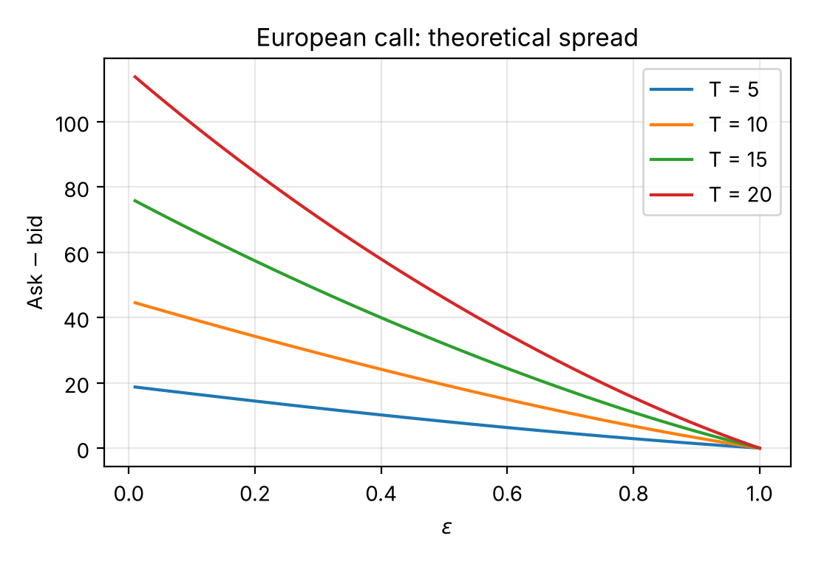 | 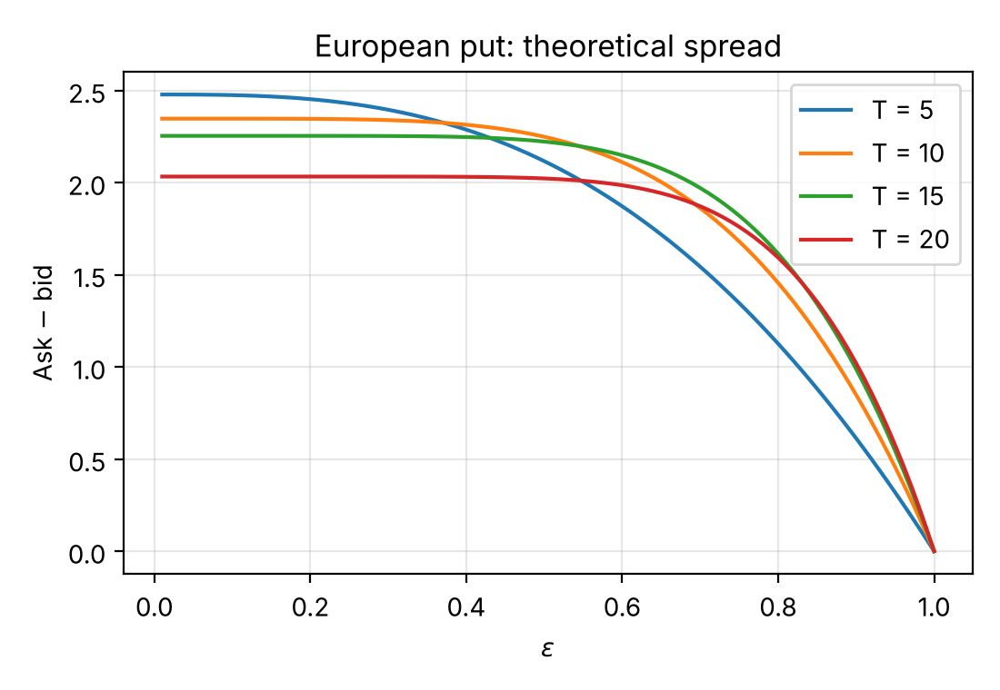 |

*Figure 1. European option spreads $\overline{C}_0-C_0$ and $\overline{P}_0-P_0$ as functions of $\epsilon\in(0,1]$.*

For non-monotone contract functions we have no explicit expression for $\lbrace Y_n\rbrace$, $\lbrace \overline{Y}_n\rbrace$ or the spread process
$\lbrace \overline{Y}_n-Y_n\rbrace$. The prices can still be computed by the backward step-wise procedure (19), (21).

**Example (straddle).** Let $T=5$, $r=0.04$, $S_0=100$, $u=1.2$, $d=0.8$, so that $\widehat{b_u}=0.6$ and
$\widehat{b_d}\in(0,0.4]$. Figure 2 shows the evolution of $\lbrace S_n\rbrace$. Let $Y_5=\max\lbrace K-S_5,0\rbrace+\max\lbrace S_5-K,0\rbrace=|S_5-K|$ be the payoff
of a straddle — a put and a call on the same underlying with the same strike — with $K=100$. Figure 3 shows the bid (a) and
ask (b) price processes $\lbrace Y_n\rbrace_{n=0}^{5}$ and $\lbrace \overline{Y}_n\rbrace_{n=0}^{5}$, with $\widehat{b_d}=0.4\cdot0.999$. Computed by
the backward recursion, the time-0 prices are **bid 35.302 and ask 35.349**. (The thesis computed this example with the
monotone formulas (22)–(25), which gives the impossible pair bid 35.342 > ask 35.309; see [Editorial changes](#editorial-changes).)

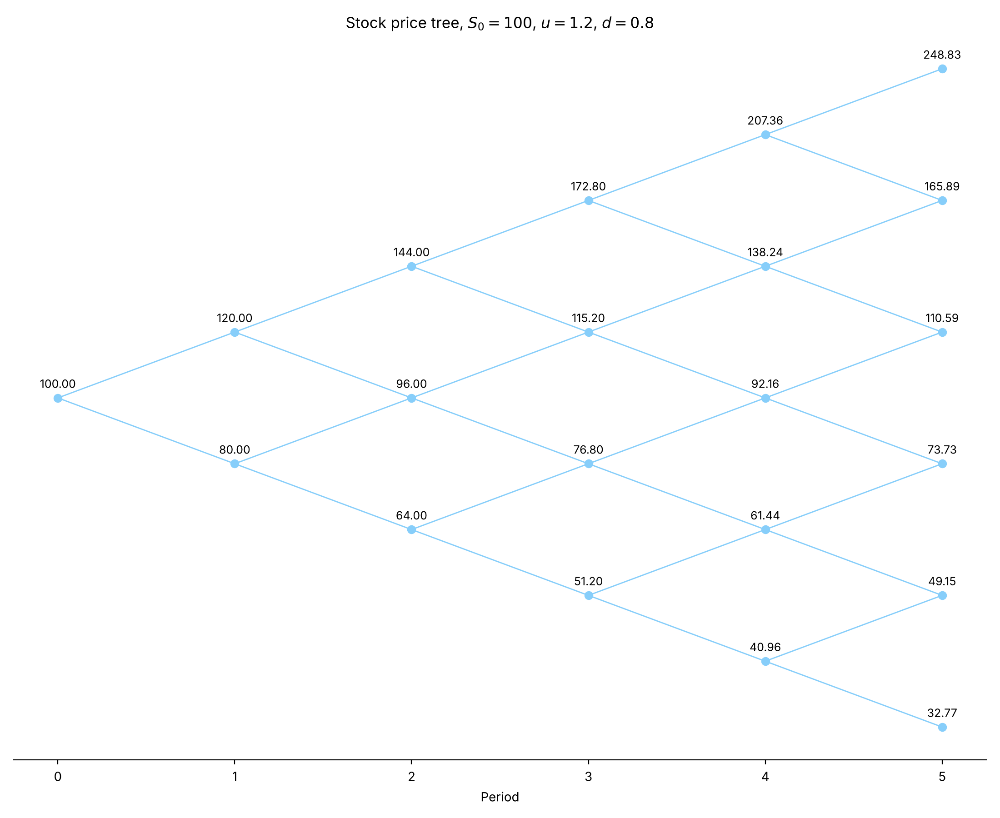

*Figure 2. Evolution of the stock bid price $\lbrace S_n\rbrace_{n=0}^{5}$ for $S_0=100$, $u=1.2$, $d=0.8$.*

| (a) bid tree | (b) ask tree |
|---|---|
| 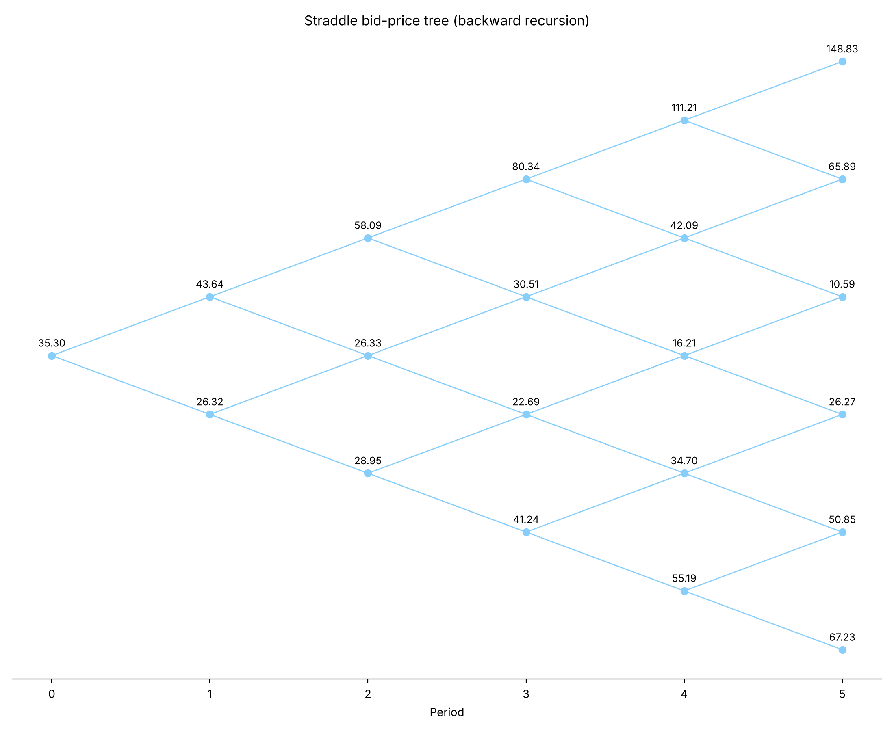 | 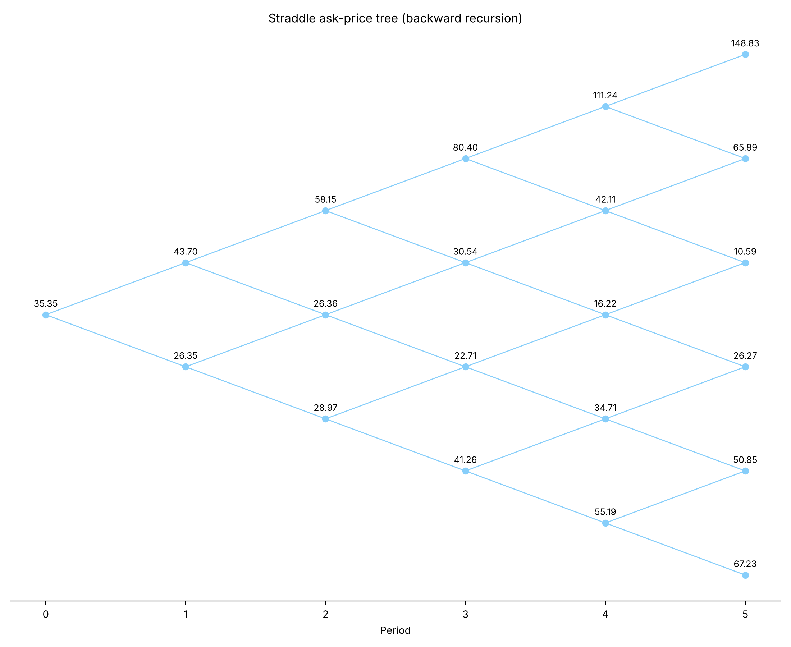 |

*Figure 3. Bid and ask price evolution of the straddle with payoff $Y_5$, computed by the Choquet backward recursion.*

### 4.2 Replication

In financial mathematics, replication prices a derivative by a portfolio of underlying assets (stock, bond) and the
risk-free asset that reproduces its payoff exactly. The core idea: if two portfolios have the same payoff in every future
state of the market, their current prices must be equal, otherwise there is arbitrage. We have discussed the bid and ask
price processes $\lbrace Y_n\rbrace$ and $\lbrace \overline{Y}_n\rbrace$. To replicate the European payoff it therefore suffices to find two
bivariate processes $\lbrace \lambda_n\rbrace$ and $\lbrace \delta_n\rbrace$, with $\lambda_n=(\lambda_n^0,\lambda_n^1)$ and
$\delta_n=(\delta_n^0,\delta_n^1)$, where $\lambda_n^0,\delta_n^0$ and $\lambda_n^1,\delta_n^1$ are the long (if positive) or
short (if negative) holdings of bond and stock.

In general the bid and ask price processes cannot be replicated by self-financing portfolios $\lbrace \lambda_n\rbrace$, $\lbrace \delta_n\rbrace$.
Indeed, to obtain a replicating portfolio, in every period $[n,n+1]$ one must pick, on the basis of the information known
at $n$ (the stock history up to $n$), random vectors $\lambda_n,\delta_n$ with the same payoff in all future market states:

$$\lambda_n^{0}B_{n+1}+\lambda_n^{1}S_{n+1}=Y_{n+1}\qquad(26)$$

$$\delta_n^{0}B_{n+1}+\delta_n^{1}S_{n+1}=\overline{Y}_{n+1}\qquad(27)$$

But the non-linear conditional Choquet expectation $\widehat{C}[\cdot\mid\mathcal{F}_n]$ means that the replicating portfolios are
in general not self-financing, since

$$\begin{aligned}
Y_n&=\tfrac{1}{1+r}\widehat{C}\big[Y_{n+1}\mid\mathcal{F}_n\big]
=\tfrac{1}{1+r}\widehat{C}\big[\lambda_n^{0}B_{n+1}+\lambda_n^{1}S_{n+1}\mid\mathcal{F}_n\big]\\
&=\tfrac{1}{1+r}\Big(\lambda_n^{0}(1+r)B_n+\widehat{C}\big[\lambda_n^{1}S_{n+1}\mid\mathcal{F}_n\big]\Big)
=\lambda_n^{0}B_n+\tfrac{1}{1+r}\widehat{C}\big[\lambda_n^{1}S_{n+1}\mid\mathcal{F}_n\big]
\ \ne\ \lambda_n^{0}B_n+\lambda_n^{1}S_n,
\end{aligned}\qquad(28)$$

$$\overline{Y}_n\ne\delta_n^{0}B_n+\delta_n^{1}S_n \qquad(29)$$

unless $\lambda_n^{1}\ge0$ and $\delta_n^{1}\le0$ (positive homogeneity of $\widehat{C}$ for non-negative multipliers). We obtain
the following proposition.

**Proposition 4.4.** Let $\varphi$ be a **monotone** contract function, $Y_T=\overline{Y}_T=\varphi(S_T)$ the payoff of a
European option, and $\widehat{\nu}$ a risk-neutral belief function with parameters $\widehat{b_d},\widehat{b_u}$ satisfying (13).
For the two bivariate processes $\lbrace \lambda_n\rbrace_{n=0}^{T-1}$ and $\lbrace \delta_n\rbrace_{n=0}^{T-1}$ defined by (26) and (27): if
$\varphi$ is non-decreasing, $\lbrace \lambda_n\rbrace$ (the bid replicating strategy) is self-financing; if $\varphi$ is non-increasing,
$\lbrace \delta_n\rbrace$ (the ask replicating strategy) is self-financing.

---
## 5. Calibration to market data

In this chapter we calibrate the market model of Chapter 3 to real market data: a default-free bond in a frictionless
market and a non-dividend-paying stock in a frictional market, the stock being quoted with a bid–ask spread. All
calibration was done in Python (the code is in this repository, see [Appendix B](#appendix-b--code)). The data come from
Yahoo! Finance through the `yfinance` package, and the options are assumed to be European.

### 5.1 Least-squares calibration

The calibration assumes that the stock bid price process $\lbrace S_n\rbrace_{n=0}^{T}$ is a DS-multiplicative random walk under an
equivalent one-step Choquet martingale belief function $\widehat{\nu}$. This means that $\widehat{\nu}$ generates a family of
$t$-step transition belief functions $\lbrace \widehat{\beta_t}\rbrace_{t=1}^{T}$ of the form (6) with parameters $\widehat{b_u}$ and
$\widehat{b_d}$. Equivalently, the discounted bid price process $\lbrace Y_n^*\rbrace$ of every European option with payoff
$Y_T=\varphi(S_T)$ is a one-step Choquet martingale and a global Choquet supermartingale, the bid prices being computed by
the backward procedure (19), (21).

The parameters to be estimated are $r,u,d$ and $\widehat{b_d}\in(0,1-\widehat{b_u}]$, where $\widehat{b_u}$ is determined by
$r,u,d$ and (13). Because the uncertainty measure considered here is non-additive, the classical calibration method of
Hull [26] does not apply. We therefore propose a least-squares procedure in which $r$ is fixed from a sovereign zero-coupon
bond and $u,d,\widehat{b_d}$ are implied by the bid and ask prices of the European options.

Let $T$ be the fixed maturity and $\mathcal{K}_{call}$, $\mathcal{K}_{put}$ the sets of available strikes of calls and puts.
For $K\in\mathcal{K}_{call}$, $C_{0,M}^{K}$ and $\overline{C}_{0,M}^{K}$ are the market bid and ask prices of the call with
strike $K$, and $C_0^K$, $\overline{C}_0^K$ the theoretical prices from Proposition 4.1. Likewise, for
$K\in\mathcal{K}_{put}$, $P_{0,M}^{K}$, $\overline{P}_{0,M}^{K}$ are the market prices and $P_0^K$, $\overline{P}_0^K$ the
theoretical prices from Proposition 4.2. Once $r$ is fixed, the theoretical prices are functions of $u,d,\widehat{b_d}$.
The *model error* is

$$E(u,d,\widehat{b_d})=\sum_{K\in\mathcal{K}_{call}}\Big[\big(C_{0,M}^K-C_0^K\big)^2+\big(\overline{C}_{0,M}^K-\overline{C}_0^K\big)^2\Big]
+\sum_{K\in\mathcal{K}_{put}}\Big[\big(P_{0,M}^K-P_0^K\big)^2+\big(\overline{P}_{0,M}^K-\overline{P}_0^K\big)^2\Big] \qquad(30)$$

and the goal is to solve

$$\min_{u,\,d,\,\widehat{b_d}} E(u,d,\widehat{b_d})\quad\text{s.t.}\quad 0<d<1+r<u, 0<\widehat{b_d}\le 1-\frac{1+r-d}{u-d}\qquad(31)$$

Problem (31) is a constrained optimisation problem in which $E(u,d,\widehat{b_d})$ is a non-linear, non-smooth objective
function containing maximum operations, because the call and put contract functions $C_0^K,\overline{C}_0^K,P_0^K,\overline{P}_0^K$
enter it. We use the Particle Swarm Optimisation (PSO) technique of Kennedy and Eberhart [18] to find the minimum; PSO is a
stochastic incomplete method operating on a fixed number of feasible solutions. In PSO the feasible solutions under the
constraints are called "particles" and form a "swarm". The method moves these particles randomly through the constrained
space and runs iteratively, taking into account hyper-parameters such as position and velocity; each particle tracks its
local best and the global best solutions in the constrained space. PSO is a metaheuristic that does not require the
objective to be differentiable, but it does not guarantee that the solution found at the end of the iterations is optimal.
For the implementation we used the PySwarm library.

**Box bounds.** In the numerical implementation we also impose box constraints on the parameters:
$(1+r)+10^{-5}\le u\le1.056$, $0\le d\le(1+r)-10^{-5}$ (when $d=1/u$ is imposed, $d$ is not a variable) and
$0.3\le\widehat{b_d}\le0.6$. These bounds are part of the problem actually solved and affect the result (see Section 5.4).

### 5.2 Data

We take the initial time $n=0$ to be 2023-09-29 and consider European calls and puts on META stock with exercise date
2023-10-27, which gives $T=20$ trading days. META was a non-dividend-paying stock until early 2024, when the company
announced quarterly dividends starting in February 2024. Figure 4 shows the market bid and ask prices of the META options
quoted on 2023-09-29 and expiring on 2023-10-27, and Figure 5 the corresponding market bid–ask spreads (both for the
original, unfiltered data set: 67 calls and 42 puts). From Figures 4(a) and 5(a) we see that, as $K$ increases, the bid–ask
spread of European calls tends to vanish, whereas Figures 4(b) and 5(b) show that the bid–ask spread of European puts tends
to widen.

| (a) calls | (b) puts |
|---|---|
| 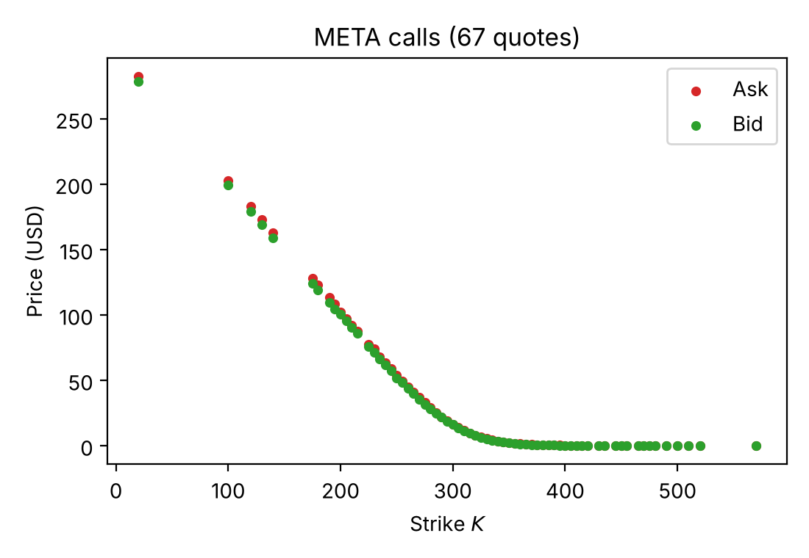 | 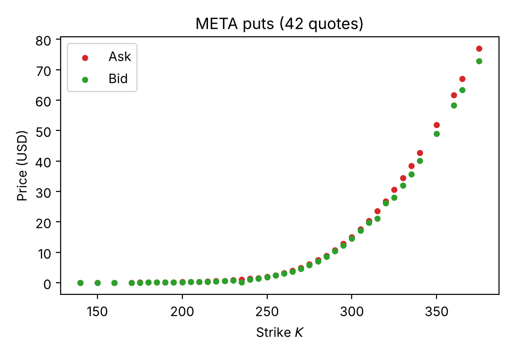 |

*Figure 4. Market bid and ask prices of META options quoted on 2023-09-29, maturity 2023-10-27, against the strike
(original data set: 67 calls, 42 puts).*

| (a) calls | (b) puts |
|---|---|
| 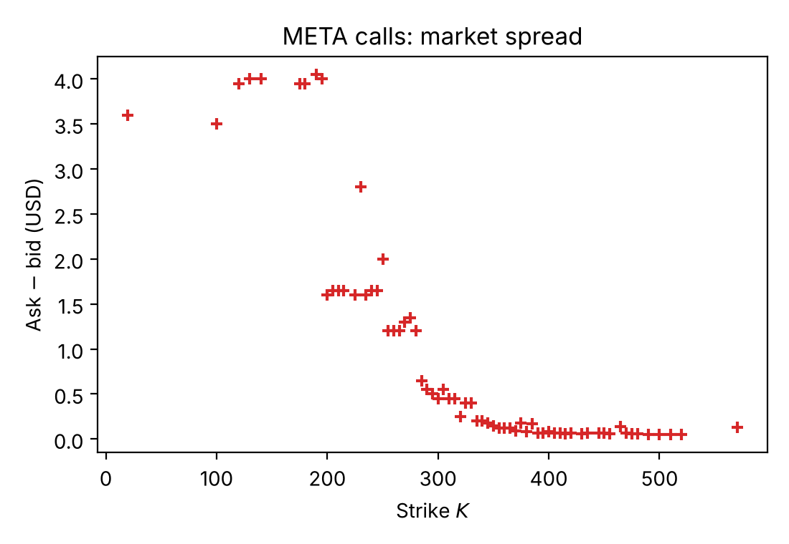 | 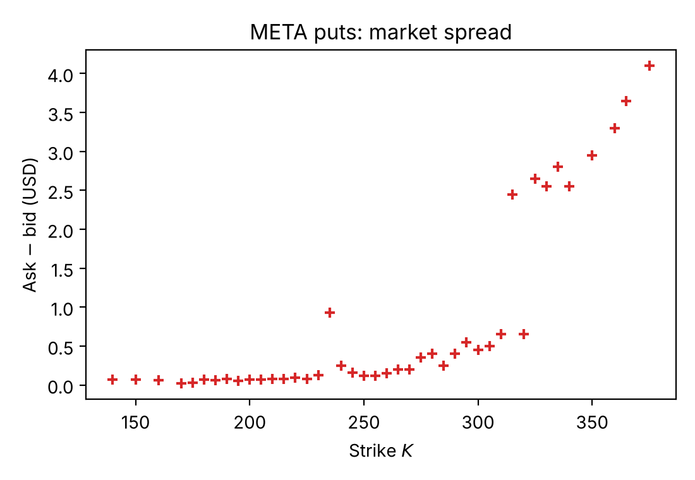 |

*Figure 5. Market bid–ask spreads of the same options against the strike.*

The risk-free rate is estimated from the 1-month US Treasury bill, with a 250-trading-day year:
$1+r=1.0555^{1/250}$ ($\approx1.000216$ per trading day).

To ease the fit, we restrict the portfolio to calls and puts with a bid–ask spread of at most USD 1, and add the META stock
market bid and ask prices $S_{0,M}=300.11$ and $\overline{S}_{0,M}=300.30$ (USD) as the prices of a degenerate call with strike
$K=0$. The final restricted data set consists of 42 calls and 33 puts, 62.69% and 78.57% of the original calls and puts. The
bid–ask spreads of calls and puts lie in $[0.05,0.65]$ and $[0.02,0.93]$ USD respectively. Note that 9 of the restricted
calls and 2 of the restricted puts have a bid price of 0 (deep out-of-the-money contracts); they are fitted together with
all other quotes.

### 5.3 Calibration with $d=1/u$

We first calibrate with $d=1/u$, so that the squared error reduces to a function of two variables,
$E(u,\widehat{b_d})=E(u,1/u,\widehat{b_d})$. With 2000 PSO iterations the minimum

$$E(u,\widehat{b_d})=21.950091\quad\text{at}\quad u=1.029428,\ \ \widehat{b_d}=0.502787$$

is attained. Note that $\widehat{b_u}=0.496474$, hence $\widehat{b_u}+\widehat{b_d}=0.999261<1$. This optimum is robust: 50
different random seeds all give the same solution. Figure 6(a) shows the error surface $E$ in three dimensions, and
Figure 6(b) its contour lines together with the minimum point (the orange region is infeasible: $\widehat{b_u}+\widehat{b_d}>1$).

| (a) error surface | (b) contours and PSO optimum |
|---|---|
| 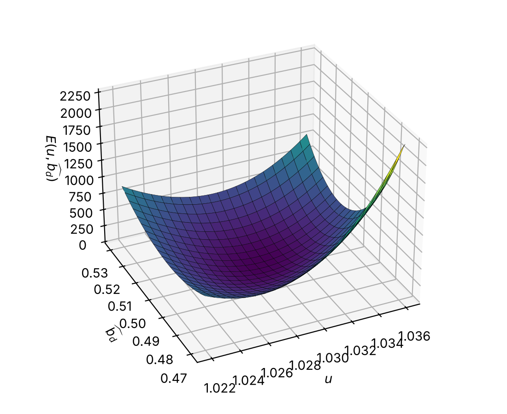 | 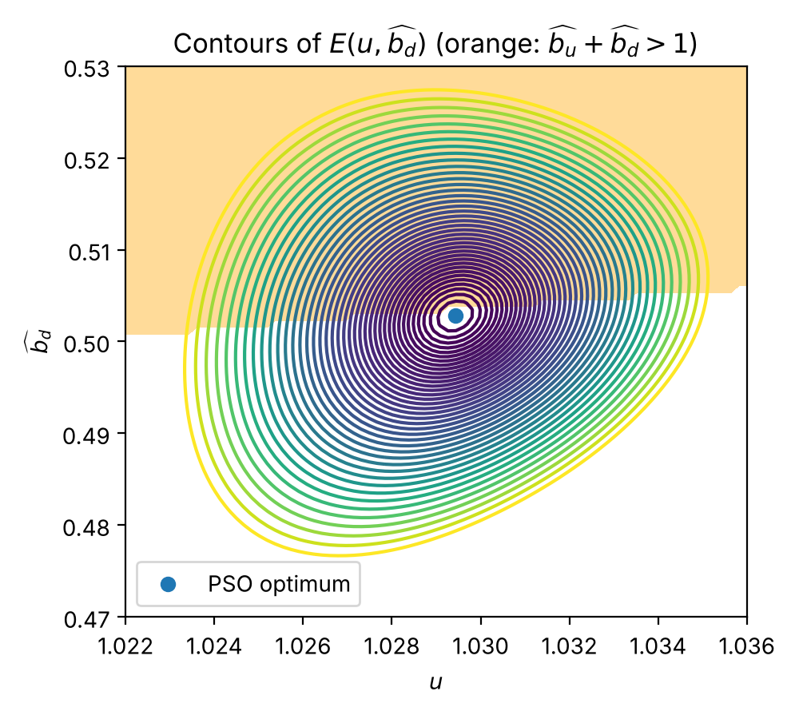 |

*Figure 6. Error surface $E(u,\widehat{b_d})$ for $d=1/u$, its contour lines and the PSO optimum.*

From the optimal $u$ and $\widehat{b_d}$ one computes the theoretical stock bid and ask prices $S_0=300.11$ and
$\overline{S}_0=300.37$ USD (the market ask is 300.30 USD). Figure 8 shows that, despite the restriction $d=1/u$, the
theoretical bid and ask prices of European calls and puts fit the market prices well.

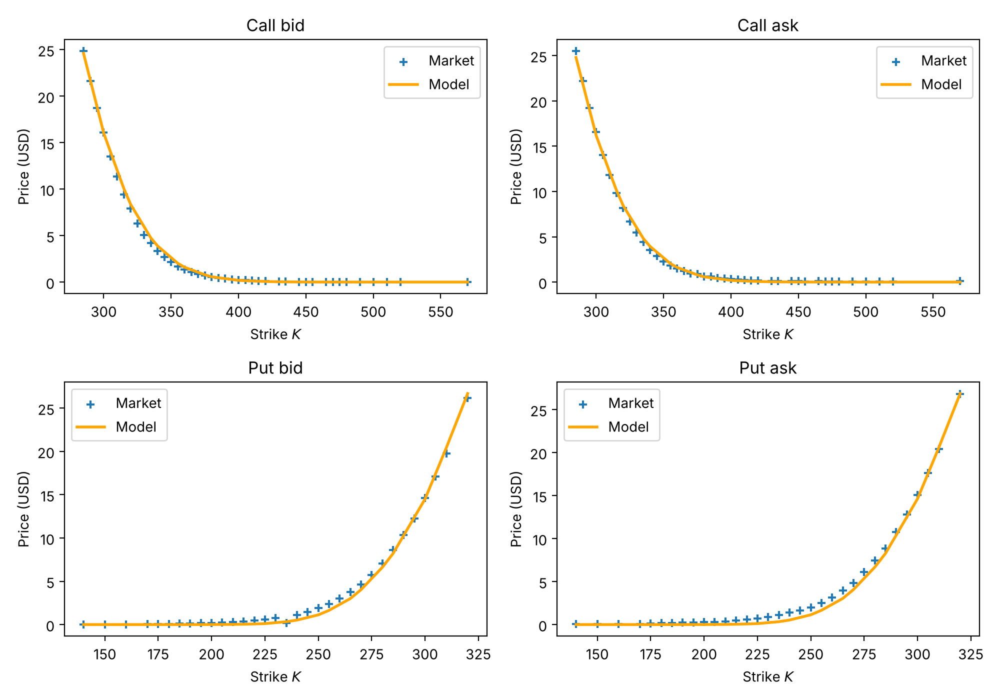

*Figure 8. Calibrated (line) against market (crosses) bid and ask prices of European calls and puts, $d=1/u$ fit.*

### 5.4 Calibration with $d$ free

Next we remove the restriction on $d$ and calibrate $u,d,\widehat{b_d}$ by minimising $E(u,d,\widehat{b_d})$. With random seed
12345 and 2000 PSO iterations we obtain $E(u,d,\widehat{b_d})=15.441812$ at $u=1.023546$, $d=0.964259$,
$\widehat{b_d}=0.392609$ (so $\widehat{b_u}=0.606494$ and $\widehat{b_u}+\widehat{b_d}=0.999102<1$). With $d$ unrestricted the
objective has several local minima, and 15.441812 is **a local minimum found by PSO, not the global minimum**. Repeating the
run with 50 random seeds and polishing with SLSQP, the errors lie mostly between 11.7 and 25 (median about 17.1; one run
failed with $E\approx4491$); the smallest value is 11.69 ($u=1.0192$, $d=0.9561$, $\widehat{b_d}=0.30$, i.e. on the lower
bound of $\widehat{b_d}$). If the bounds of $\widehat{b_d}$ are relaxed to $[0.01,0.99]$, the minimum error drops to 9.47
($\widehat{b_d}\approx0.21$), but only 2 of 50 seeds reach it. By contrast, for $d=1/u$ all 50 seeds give the same solution
($E=21.950091$). The parameters above are therefore used below, but should be read as a well-fitting, reproducible set
rather than as *the* optimum.

| Calibration | $u$ | $d$ | $\widehat{b_d}$ | $E$ | Price RMSE (USD / quote) | Mean model spread (USD) | Mean market spread (USD) |
|---|---|---|---|---|---|---|---|
| $d=1/u$ | 1.029428 | 0.971413 | 0.502787 | 21.950091 | 0.380 | 0.036 | 0.202 |
| $d$ free (thesis run) | 1.023546 | 0.964259 | 0.392609 | 15.441812 | 0.319 | 0.044 | 0.202 |
| $d$ free (best found, thesis bounds) | 1.019239 | 0.956200 | 0.300884 | 11.741323 | 0.278 | 0.046 | 0.202 |

*Table 1. Calibration results on the restricted data set (market spread excludes the strike-0 stock quote).*

Using the calibrated parameters, we compute the theoretical put spread as a function of the strike (Figure 7). The European
spread is close to a weighted sum of piecewise-linear functions of $K$, in agreement with Proposition 4.2, and the
increasing relation between the European put spread and $K$ is consistent with the market bid–ask spreads of Figure 5(b).

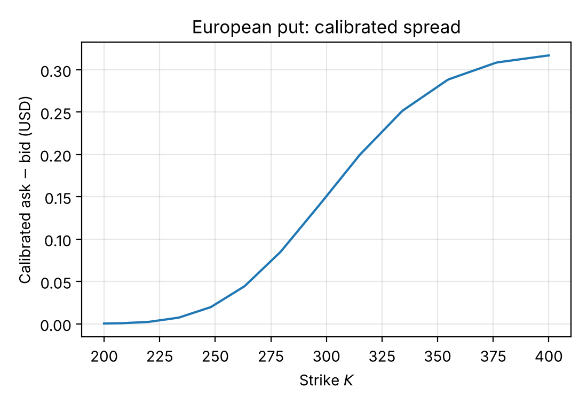

*Figure 7. Calibrated theoretical bid–ask spread of European puts against the strike $K$ (free-$d$ parameters).*

### 5.5 Prices fit well, spread levels do not

The model reproduces market bid and ask **prices** well and reproduces the **shape** of the put spread (increasing with the
strike), but the **level** of the model spreads is clearly narrower than that of the market (Table 1): on the restricted
data set (without the stock quote) the average market spread is about USD 0.20, whereas the calibrated model has an average
spread of about USD 0.04. The reason is that the model uses a single parameter $\widehat{b_d}$ to control the spreads of all
strikes and of both option types; even when more weight is put on the spread in the objective function, the average model
spread can only be raised to about USD 0.12 (see [`results/objective_comparison.csv`](../../results/objective_comparison.csv)).
Reproducing the amplitude of market spreads would require more spread parameters (for example a $\widehat{b_d}$ depending on
the strike or on the option type).

---

## 6. Conclusions and outlook

In the continuous-time limit the DS-multiplicative random walk yields a DS-geometric Brownian motion. Studying this
process further in the limit, and the resulting theory corresponding to the model of Cinfrignini et al. [17], may offer new
ideas for the calibration or estimation of the parameters of the discrete-time model treated here.

Based on Dempster–Shafer evidence theory, this report considered the dynamic bid–ask pricing model for frictional markets
introduced by Cinfrignini et al. [17], defined the risk-neutral belief function and the conditional Choquet expectation
operator, and thereby gave a new approach to European option pricing. We showed that, for non-decreasing (non-increasing)
contract functions, the bid (ask) formula is independent of the parameter $\widehat{b_d}$ and the replicating strategy is
self-financing; for monotone contract functions the model gives an explicit expression of the bid price, and the explicit
expression of the ask price can also be determined by the step-wise backward method, but this is not true for non-monotone
contract functions. The experiments show that the calibrated pricing formulas fit the market bid and ask **prices** of META
stock options well and reproduce the increase of put spreads with the strike; a single $\widehat{b_d}$, however, is not
enough to reproduce the full amplitude of market spreads (model average about USD 0.04, market about USD 0.20).

The contribution is the construction of the DS-multiplicative random walk and the DS-geometric Brownian motion with the
corresponding conditional Choquet expectation operator, which offer a new approach to bid–ask pricing of European options in
frictional markets. In addition, PSO was used to calibrate the model to market data, validating its feasibility.

The study has several limitations in both theory and application:

1. For non-monotone contract functions the bid and ask formulas do not become independent of the parameter choice and the
   replicating strategy is not necessarily self-financing, so no explicit expression of European derivatives can be given.
2. The follow-up study of the continuous-time $t$-step transition belief function depends on the applicability of the
   Choquet weak convergence of Feng and Nguyen [23] in the limit, and this theoretical framework is not yet complete.
3. The thesis does not treat bid–ask pricing of American derivatives, mainly because the several possible early-exercise
   scenarios of American puts make the terminal payoff function too complex. (This repository adds an exploratory American-put
   extension, documented in [`docs/AMERICAN.md`](../AMERICAN.md); it is not part of the thesis.)
4. The calibration only validates the ability of the pricing formulas to fit bid and ask prices; their practical use also
   requires studying the stability of the fitted parameters for a single contract function (the free-$d$ calibration is
   sensitive to the PSO random seed, see Section 5.4) and how to introduce more spread parameters to reproduce the
   amplitude of the market spreads.

The model is a more complex one that awaits further development. Future work can go in three directions. First, extend the
application scope: the model targets European options, and its use for American options, exotic options or cross-asset
portfolio pricing can be studied to increase its generality. Second, carry out more empirical research, applying the model to
other markets and asset types to test its applicability under different market conditions, and use high-frequency data to
analyse market microstructure and pricing under dynamic changes. Third, the present empirical work uses static market data;
real-time data streams are needed to test the dynamic adaptability of the model and to explore its potential value in
algorithmic trading.

---

## Appendix A — Proofs

Throughout, $\widehat{C}[\cdot\mid S_n=s]$ of a function $f$ of $S_{n+1}$ has, cf. Proposition 3 of [17], the one-step form

$$\widehat{C}\big[f(S_{n+1})\mid S_n=s\big]=\widehat{b_u}f(us)+\widehat{b_d}f(ds)+\big(1-\widehat{b_u}-\widehat{b_d}\big)\min\lbrace f(us),f(ds)\rbrace,$$

and the dual (upper) expectation $-\widehat{C}[-f(S_{n+1})\mid S_n=s]$ is the same expression with $\max$ instead of $\min$.

### Proof of Proposition 4.1

For the bid price, [17, Proposition 4] shows that the process (19) for a non-decreasing $\varphi$ does not depend on the
choice of $\widehat{b_d}\in(0,1-\widehat{b_u}]$; the corresponding ask process (21) does. We prove the statement by backward
induction. Put $\varphi_T=\overline{\varphi}_T=\varphi$ on $\mathcal{S}_T$, with $\varphi$ non-decreasing. For $n=T-1$ and
$s_{T-1}\in\mathcal{S}_{T-1}$ define $\varphi_{T-1},\overline{\varphi}_{T-1}:\mathcal{S}_{T-1}\to\mathbb{R}$ by

$$\varphi_{T-1}(s_{T-1})=\frac{1}{1+r}\widehat{C}\big[\varphi_T(S_T)\mid S_{T-1}=s_{T-1}\big]=\frac{1}{1+r}\Big(\widehat{b_u}\varphi_T(us_{T-1})+\big(1-\widehat{b_u}\big)\varphi_T(ds_{T-1})\Big),$$

$$\overline{\varphi}_{T-1}(s_{T-1})=-\frac{1}{1+r}\widehat{C}\big[-\overline{\varphi}_T(S_T)\mid S_{T-1}=s_{T-1}\big]=\frac{1}{1+r}\Big(\big(1-\widehat{b_d}\big)\overline{\varphi}_T(us_{T-1})+\widehat{b_d}\,\overline{\varphi}_T(ds_{T-1})\Big),$$

where the last equalities follow from the one-step form above: since $\varphi_T$ is non-decreasing, $\varphi_T(ds)\le\varphi_T(us)$, so
the minimum is attained at $ds$ (weights $\widehat{b_u}$ and $1-\widehat{b_u}$) and the maximum at $us$ (weights
$1-\widehat{b_d}$ and $\widehat{b_d}$). The functions $\varphi_{T-1},\overline{\varphi}_{T-1}$ are non-decreasing: they are
combinations with non-negative weights of $s\mapsto\varphi_T(us)$ and $s\mapsto\varphi_T(ds)$, both non-decreasing in $s$.

Now suppose that, for some $n\in\lbrace 0,\dots,T-1\rbrace$, $\varphi_{n+1},\overline{\varphi}_{n+1}:\mathcal{S}_{n+1}\to\mathbb{R}$ are
non-decreasing, and define for $s_n\in\mathcal{S}_n$

$$\varphi_n(s_n)=\frac{1}{1+r}\Big(\widehat{b_u}\varphi_{n+1}(us_n)+\big(1-\widehat{b_u}\big)\varphi_{n+1}(ds_n)\Big),\qquad
\overline{\varphi}_n(s_n)=\frac{1}{1+r}\Big(\big(1-\widehat{b_d}\big)\overline{\varphi}_{n+1}(us_n)+\widehat{b_d}\,\overline{\varphi}_{n+1}(ds_n)\Big).$$

By the same argument $\varphi_n,\overline{\varphi}_n$ are non-decreasing. Finally, substituting the expression of
$\varphi_{n+1}$ into $\varphi_n$, starting from $n=T-1$ and going backwards, gives (22) and (23): this is the classical
binomial recursion with up-probability $\widehat{b_u}$ for the bid price and $1-\widehat{b_d}$ for the ask price. $\square$

### Proof of Proposition 4.2

The proof is the same with $\varphi$ non-increasing, but the roles of the weights are **exchanged**: if $\varphi_{n+1}$ is
non-increasing, $\varphi_{n+1}(us)\le\varphi_{n+1}(ds)$, so the minimum is attained at $us$ and the maximum at $ds$, and

$$\varphi_n(s_n)=\frac{1}{1+r}\Big(\big(1-\widehat{b_d}\big)\varphi_{n+1}(us_n)+\widehat{b_d}\,\varphi_{n+1}(ds_n)\Big),\qquad
\overline{\varphi}_n(s_n)=\frac{1}{1+r}\Big(\widehat{b_u}\,\overline{\varphi}_{n+1}(us_n)+\big(1-\widehat{b_u}\big)\overline{\varphi}_{n+1}(ds_n)\Big).$$

(The thesis wrote here the same one-step formulas as in the proof of Proposition 4.1, which is a copy-and-paste slip; the
statement (24)–(25) is the correct one.) Both $\varphi_n,\overline{\varphi}_n$ are non-increasing, being non-negative
combinations of non-increasing functions of $s$. Unrolling the recursion from $n=T-1$ gives (24) and (25). $\square$

### Proof of Proposition 4.3

This is a direct consequence of Propositions 4.1 and 4.2: with $\widehat{b_d}=\epsilon(1-\widehat{b_u})$ the bid and ask prices
are binomial sums whose weights are polynomials of degree at most $T$ in $\epsilon$ (the bid weights do not depend on
$\epsilon$ for a non-decreasing $\varphi$, the ask weights $(1-\epsilon(1-\widehat{b_u}))^{k}(\epsilon(1-\widehat{b_u}))^{T-k}$
do, and symmetrically for a non-increasing $\varphi$); hence so is their difference, and it vanishes at $\epsilon=1$.
(The thesis states degree $T$; it is exactly $T$ unless the $T$-th lattice difference of $\varphi$ vanishes.) $\square$

### Proof of Proposition 4.4

*Non-decreasing $\varphi$.* By the proof of Proposition 4.1, (26) can be rewritten as

$$\begin{cases}\lambda_n^0(1+r)B_n+\lambda_n^1uS_n=\varphi_{n+1}(uS_n),\\ \lambda_n^0(1+r)B_n+\lambda_n^1dS_n=\varphi_{n+1}(dS_n),\end{cases}$$

where $\varphi_{n+1}$ is a non-decreasing function on the range of $S_{n+1}$. Hence

$$\lambda_n^1=\frac{\varphi_{n+1}(uS_n)-\varphi_{n+1}(dS_n)}{uS_n-dS_n}\ge0,$$

which gives

$$\begin{aligned}Y_n&=\tfrac1{1+r}\widehat{C}[Y_{n+1}\mid\mathcal{F}_n]=\tfrac1{1+r}\widehat{C}\big[\lambda_n^0B_{n+1}+\lambda_n^1S_{n+1}\mid\mathcal{F}_n\big]\\
&=\tfrac1{1+r}\Big(\lambda_n^0(1+r)B_n+\widehat{C}\big[\lambda_n^1S_{n+1}\mid\mathcal{F}_n\big]\Big)=\lambda_n^0B_n+\lambda_n^1S_n,\end{aligned}$$

where the last equality uses [17, Proposition 2] and (19): since $\lambda_n^1\ge0$,
$\tfrac1{1+r}\widehat{C}[\lambda_n^1S_{n+1}\mid\mathcal{F}_n]=\lambda_n^1\tfrac1{1+r}\widehat{C}[S_{n+1}\mid\mathcal{F}_n]=\lambda_n^1S_n$.

*Non-increasing $\varphi$.* Likewise, (27) becomes

$$\begin{cases}\delta_n^0(1+r)B_n+\delta_n^1uS_n=\overline{\varphi}_{n+1}(uS_n),\\ \delta_n^0(1+r)B_n+\delta_n^1dS_n=\overline{\varphi}_{n+1}(dS_n),\end{cases}$$

with $\overline{\varphi}_{n+1}$ non-increasing, so

$$\delta_n^1=\frac{\overline{\varphi}_{n+1}(uS_n)-\overline{\varphi}_{n+1}(dS_n)}{uS_n-dS_n}\le0,$$

and

$$\begin{aligned}\overline{Y}_n&=-\tfrac1{1+r}\widehat{C}[-\overline{Y}_{n+1}\mid\mathcal{F}_n]=-\tfrac1{1+r}\widehat{C}\big[-\delta_n^0B_{n+1}-\delta_n^1S_{n+1}\mid\mathcal{F}_n\big]\\
&=\delta_n^0B_n-\tfrac1{1+r}\widehat{C}\big[-\delta_n^1S_{n+1}\mid\mathcal{F}_n\big]=\delta_n^0B_n+\delta_n^1S_n,\end{aligned}$$

because $-\delta_n^1\ge0$ gives $-\tfrac1{1+r}\widehat{C}[-\delta_n^1S_{n+1}\mid\mathcal{F}_n]=-(-\delta_n^1)\tfrac1{1+r}\widehat{C}[S_{n+1}\mid\mathcal{F}_n]=\delta_n^1S_n$. $\square$

(For the *other* price of each case — the bid of a put, the ask of a call — the stock holding has the wrong sign and the
replication is not self-financing whenever $\widehat{b_d}<1-\widehat{b_u}$; this is checked numerically in `dsbidask.replication`
and `tests/`.)

---

## Appendix B — Code

The thesis appendix reproduced five code blocks. Their English, tested counterparts live in the repository:

| Thesis appendix block | Repository |
|---|---|
| Option binomial-tree drawing tool (`plotPutTree`, …) | `dsbidask.plotting.plot_tree` |
| Option-case bid/ask price computation (put, straddle) | `dsbidask.pricing` (closed forms, Props. 4.1–4.2) and `dsbidask.choquet.bid_ask_trees` (recursion (19)/(21)) |
| Market data processing and display | `dsbidask.data`, `scripts/make_figures.py`, `scripts/make_report_figures.py` |
| "Partially restricted PSO" ($d=1/u$) | `dsbidask.calibration.calibrate(free_d=False)` |
| "Unrestricted PSO" (free $d$) | `dsbidask.calibration.calibrate(free_d=True)`; multi-start: `calibrate_multistart` |

Stand-alone corrected versions of the appendix code (free-$d$ PSO, straddle recursion, $\epsilon$-grid) are in
[`docs/thesis_corrections/`](../thesis_corrections/). Reproduce the report figures with
`python scripts/make_report_figures.py`, the calibration with `python scripts/calibrate.py`.

---

## Editorial changes

This edition differs from the Chinese thesis as follows (items marked **E** are errors found while translating; the rest are
the audit results of [`docs/THESIS_ERRATA.md`](../THESIS_ERRATA.md)).

**Content corrections**

- **C1, C2, C6** (appendix code): free-$d$ PSO code restored; straddle priced by the Choquet recursion (bid 35.302, ask 35.349
  instead of the impossible 35.342 > 35.309); $\epsilon$ grid $(0,1]$.
- **C4, C5** (Section 5.1, 5.4): box bounds stated; the free-$d$ minimum 15.441812 is described as a local minimum, with the
  multi-seed range.
- **C7, H1, H2** (Section 5.2 and figure captions): the (a)/(b) panels of Figure 4 were swapped in the thesis; maturity is
  2023-10-27 (not 10-23); the data set of Figures 4–5 is stated; the comparison after Figure 7 refers to Figure 5(b), not Figure 1.
- **D2, D3**: zero-bid quotes disclosed; theoretical stock ask is 300.37 for $d=1/u$ (300.43 for free $d$).
- **H3, H4**: Proposition 4.4 is stated for monotone contract functions; the hat in (22) and (25) is on $b_u$, not on $b_u^k$.
- **H5, H6**: "objective function with a maximum" read as "containing maximum operations"; the claim that the model fits
  market spreads is replaced by the accurate statement (prices well, spread level too narrow).

**Errors found while translating (E)**

- **E1** Proof of Proposition 4.2 reused the one-step formulas of Proposition 4.1 (weights not exchanged); corrected.
- **E2** In the proofs, $\overline{\varphi}_T(s_{T-1})$ and $\varphi_n(s_{T-1})$ should read $\overline{\varphi}_{T-1}(s_{T-1})$ and $\varphi_n(s_n)$.
- **E3** Figure 2's caption said $n=0,\dots,3$, but the tree has $n=0,\dots,5$.
- **E4** After (13) the thesis wrote "$\widehat{b_u}\in(0,1-\widehat{b_u}]$"; it is $\widehat{b_d}$. In Section 2.1, $\max_{P\in\mathrm{core}(A)}$ is
  $\max_{P\in\mathrm{core}(\nu)}$, and in (2) $E_i^{\sigma}=\lbrace \omega_{\sigma(1)},\dots,\omega_{\sigma(i)}\rbrace$.
- **E5** Discussion of Figure 1: the thesis said the spread curves show no clear dependence on $T$; the call spread clearly grows
  with $T$ (numbers in Section 4.1). Proposition 4.3: degree *at most* $T$.
- **E6** Whole-document: Chinese terms normalised (e.g. "DS-multiplicative random walk" instead of "stochastic wandering").

---

## References

1. Merton R., Optimum consumption and portfolio rules in a continuous-time model. *J. Econ. Theory*, 1971, 3(3), 373–413.
2. Duffie D., *Security Markets: Stochastic Models*. Academic Press, Boston, 1988.
3. Pliska S., *Introduction to Mathematical Finance: Discrete Time Models*. Blackwell, Oxford, 1997.
4. Cox J.C., Ross S.A., Rubinstein M., Option pricing: a simplified approach. *J. Financ. Econ.*, 1979, 7(3), 229–263.
5. Amihud Y., Mendelson H., Asset pricing and the bid–ask spread. *J. Financ. Econ.*, 1986, 17, 223–249.
6. Amihud Y., Mendelson H., Liquidity, maturity, and the yields on U.S. treasury securities. *J. Finance*, 1991, 46, 1411–1425.
7. Araujo A., Chateauneuf A., Faro J., Pricing rules and Arrow–Debreu ambiguous valuation. *Econ. Theory*, 2012, 49, 1–35.
8. Cerreia-Vioglio S., Maccheroni F., Marinacci M., Put-call parity and market frictions. *J. Econ. Theory*, 2015, 157, 730–762.
9. Bastianello L., Chateauneuf A., Cornet B., Put-call parities, absence of arbitrage opportunities and non-linear pricing rules. *Math. Finance*, 2024, 1–21.
10. Chateauneuf A., Cornet B., The risk-neutral non-additive probability with market frictions. *Econ. Theory Bull.*, 2022, 10, 13–25.
11. Cinfrignini A., Petturiti D., Vantaggi B., Envelopes of equivalent martingale measures and a generalized no-arbitrage principle in a finite setting. *Ann. Oper. Res.*, 2023, 321, 103–137.
12. Petturiti D., Vantaggi B., No-arbitrage pricing with α-DS mixtures in a market with bid–ask spreads. In *Proc. 13th Int. Symposium on Imprecise Probability: Theories and Applications*, Oviedo, 2023, 215, 401–411.
13. Jouini E., Price functionals with bid–ask spreads: an axiomatic approach. *J. Math. Econ.*, 2000, 34, 547–558.
14. Bion-Nadal J., Bid–ask dynamic pricing in financial markets with transaction costs and liquidity risk. *J. Math. Econ.*, 2009, 45, 738–750.
15. Carr P., Zhu Q., *Convex Duality and Financial Mathematics*. SpringerBriefs in Mathematics, Springer, 2018.
16. Driouchi T., Trigeorgis L., Gao Y., Choquet-based European option pricing with stochastic (and fixed) strikes. *OR Spectrum*, 2015, 37, 787–802.
17. Cinfrignini A., Petturiti D., Vantaggi B., Dynamic bid–ask pricing under Dempster–Shafer uncertainty. *J. Math. Econ.*, 2023, 107, 102871.
18. Kennedy J., Eberhart R., *Swarm Intelligence*. Morgan Kaufmann, San Francisco, 2001.
19. Suppes P., Zanotti M., On using random relations to generate upper and lower probabilities. *Synthese*, 1977, 36, 427–440.
20. Dempster A., Upper and lower probabilities induced by a multivalued mapping. *Ann. Math. Stat.*, 1967, 38, 325–339.
21. Shafer G., *A Mathematical Theory of Evidence*. Princeton University Press, 1976.
22. Choquet G., Theory of capacities. *Ann. Inst. Fourier*, 1954, 5, 131–295.
23. Feng D., Nguyen H., Choquet weak convergence of capacity functionals of random sets. *Inf. Sci.*, 2007, 177, 3239–3250.
24. Jaffray J.-Y., Coherent bets under partially resolving uncertainty and belief functions. *Theory Decis.*, 1989, 26, 99–105.
25. Černý A., *Mathematical Techniques in Finance: Tools for Incomplete Markets*, 2nd ed. Princeton University Press, 2009.
26. Hull J., *Options, Futures, and Other Derivatives*, 10th ed. Pearson, New York, 2018.
